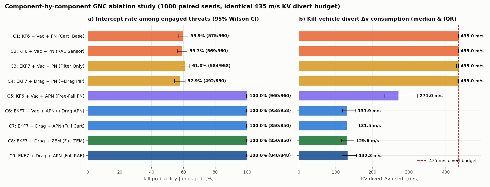
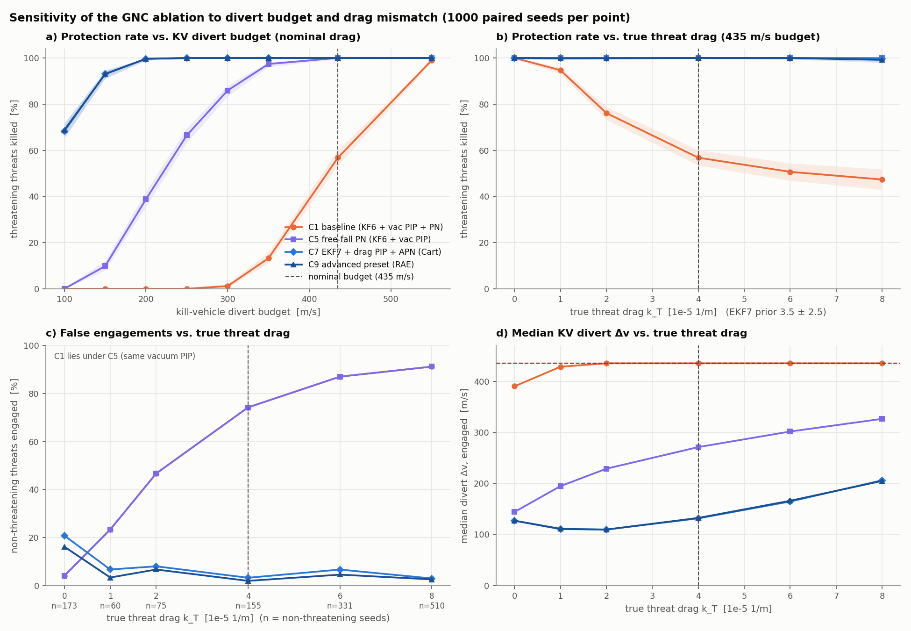
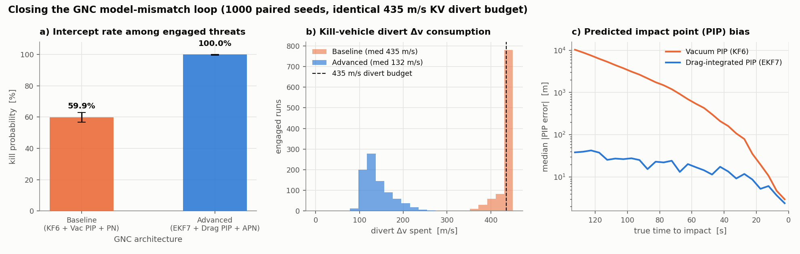

# THAAD-Style Terminal Intercept Simulation

[](https://doi.org/10.5281/zenodo.24208792)

A deterministic Python simulation of **terminal ballistic missile defense**—modeling radar sensing, Kalman state estimation, impact-point fire control, proportional/optimal guidance, and hit-to-kill two-stage vehicle dynamics.

> ⚠️ An educational and hobby simulation. It models no real weapon system, and all vehicle, sensor, and engagement numbers are illustrative.

---

## Documentation Map

| Guide | What's Inside |
| --- | --- |
| **Overview (this page)** | Simulation scope, closed-loop architecture, YAML modes, headline results, and repository map |
| **[How to Run](docs/running.md)** | Installation, CLI deterministic runs, multi-core Monte Carlo & `--sweep` campaigns, `--serve`, and `pytest` |
| **[Mathematical Model & Verification](docs/methods.md)** | Equations of motion, RK4 burnout splitting, KF6/EKF7, RAE covariance, PN/APN/ZEM laws, and NEES/NIS proofs |
| **[Viewer Characteristics](docs/visualizers.md)** | Live FastAPI Workstation (`--serve`), offline 3D HTML replays, batch dashboard, controls, and frontend architecture |

---

## What the Simulation Models

Every engagement runs a closed six-stage GNC loop over flat-Earth East–North–Up (ENU) coordinates, uniquely determined by a YAML config and a random seed:

1. **Detection** — Ballistic threat under quadratic drag; radar returns noisy measurements in `cartesian` coordinates or polar Range–Azimuth–Elevation (`rae`) with Doppler range-rate.
2. **Estimation** — Tracks the threat using a **6-state linear Kalman filter** (`kf6`, assuming vacuum free-fall) or a **7-state Extended Kalman Filter** (`ekf7`) that estimates the threat's ballistic drag coefficient $k_T$ in flight.
3. **Fire Control** — Predicts the threat's impact point (`vacuum` parabola or RK4 `drag` integration) and gates launch (`pip_gated` vs. `fire_on_track`) against the defended perimeter.
4. **Guidance & Control** — Commands lateral acceleration via **Classical PN** (`pn`), **Augmented PN** (`apn` with EKF drag feed-forward), or **Optimal ZEM** (`zem`), constrained by lateral $g$-limits, 1st-order actuator lag $\tau$, and a finite kill-vehicle divert $\Delta v$ budget.
5. **Physics & Integration** — Two-stage interceptor (booster with mass flow $F / (I_{sp} g_0)$, separation at burnout, kinetic kill vehicle) integrated with **RK4** (with exact burnout sub-step splitting) or Forward Euler.
6. **Kill Assessment** — Continuous chord closest-point-of-approach (CPA) intersection across kill radius $R_k$ and terminal Battle Damage Assessment.

See **[docs/methods.md](docs/methods.md)** for all governing equations, Jacobians, assumptions, and verification details.

---

## Modes & Key Engineering Insight

All scenarios run the exact same simulation code; only YAML settings change (`configs/`):

| Mode | Radar, Filter & Guidance | Interceptor Limits | Outcome Highlight |
| --- | --- | --- | --- |
| [`configs/engineering.yaml`](configs/engineering.yaml) | Cartesian radar, `kf6`, vacuum PIP, classical `pn` | 150 kN (5 s), 30 g, 435 m/s divert budget, 10 m $R_k$ | **56.8%** of threatening threats killed (480 / 845, 95% CI 53.4–60.1%); all 385 misses exhaust divert $\Delta v$ |
| [`configs/advanced.yaml`](configs/advanced.yaml) | Polar `rae` radar, `ekf7`, drag PIP, `apn` | Identical 150 kN (5 s), 30 g, 435 m/s divert, 10 m $R_k$ | **100%** of threatening threats killed (845 / 845, 95% CI 99.5–100%) at a median 132 m/s divert $\Delta v$ |
| [`configs/demo.yaml`](configs/demo.yaml) | Cartesian radar, `kf6`, vacuum PIP, classical `pn` | 220 kN (8 s), 50 g, unlimited divert, 30 m $R_k$ | **100%** (1000 / 1000, 95% CI 99.6–100%) |

"Threatening" means the unintercepted threat would land inside the 30 km defended radius (845 of seeds 0–999). This denominator is the same for every configuration, unlike the kill rate among engaged threats, which depends on each configuration's own launch decisions.

**What limits the baseline: a 1000-seed paired ablation** ([`scripts/ablation_study.py`](scripts/ablation_study.py)). Changing one GNC component at a time on the same seeds shows that one guidance term recovers every lost kill. Classical PN commands $+g$ throughout the kill vehicle's coast, although gravity cancels between two free-falling bodies, so the term pushes the vehicle off course and then spends divert $\Delta v$ correcting it. Removing that term alone (KF6 and vacuum PIP unchanged) raises protection from 56.8% to 100% (365 seeds rescued, none lost; exact McNemar $p < 10^{-100}$) and cuts median divert use from 435 to 271 m/s. Adding drag to the filter without changing the guidance barely helps (58%). The drag-aware software then does two different jobs:

- **EKF7 drag feed-forward** halves divert use again (271 → 132 m/s median).
- **The drag-integrated PIP** cuts launches at threats that would have landed outside the defended area from 115 to 5 (of 155).

The RAE radar and ZEM vs. APN change neither outcome measurably, and sweeping radar noise from 5 m to 100 m moves the baseline by only 4.4 points.



**Sensitivity sweeps** ([`scripts/sensitivity_study.py`](scripts/sensitivity_study.py), 56,000 more paired runs). The baseline's misses need two things at once: the coast gravity term and threat drag that the filter does not model. Against a drag-free threat the baseline also protects 100%, and without the gravity term protection stays at 100% for every threat drag tested (0 to 8 × 10⁻⁵ 1/m). The feed-forward's margin turns into kills when the budget is tight. The smallest tested budget for ≥ 99% protection is 550 m/s for the baseline, 435 m/s without the gravity term, and 200 m/s with EKF7 drag feed-forward. One cost also showed up: against a drag-free threat the drag PIP launches at more threats that will land outside the defended area (36 vs. 7 of 173), because it decides after 5 s of tracking while its drag estimate is still near the prior. Details in [docs/methods.md](docs/methods.md#sensitivity-to-divert-budget-and-threat-drag-1000-paired-seeds-per-point).






---

## Verification Snapshot

- **Integrator order** (`scripts/convergence_study.py`): Step-halving confirms order **1.00** (Euler) and **4.01** (RK4) on dragged threats, and **0.99** / **4.00** across interceptor booster burnout. With drag off, RK4 matches the closed-form solution to $6 \times 10^{-11}\text{ m}$.
- **Kalman consistency** (`scripts/filter_consistency.py`): Over 50 seeded runs, 6-DOF NEES/NIS stay inside the 95% $\chi^2$ interval $[5.08, 7.00]$ when matched (mean NEES **6.11**, **94.3%** inside; NIS **5.99**, **95.1%** inside), while `kf6` on a dragged threat drops to **58.9%** NEES coverage—quantifying the drag mismatch solved by `ekf7`.

---

## Quick Start

```bash
pip install -e ".[dev,plot,workstation]"

python -m thaad_sim --config configs/engineering.yaml --seed 13   # Single run -> offline 3D HTML replay
python -m thaad_sim --serve                                       # Live FastAPI GNC Workstation
python -m thaad_sim.batch --config configs/engineering.yaml --n 1000
python -m pytest
```

Full commands, sweep options, and study scripts: **[docs/running.md](docs/running.md)**.

---

## Visualization Layers

Two browser tools sit on top of `thaad_sim/` without altering the physics core (details in **[docs/visualizers.md](docs/visualizers.md)**):

- **Live Workstation (`--serve`)** — FastAPI server (`server.py`, `telemetry.py`, `workstation/`) running the real Python engine on demand for 3D inspection, optical seeker inset, 14 synchronized GNC/filter plots, 3-law comparisons, and multi-core live Monte Carlo batches.
- **Offline Replays & Batch Dashboard (`viewer/`)** — Zero-dependency single-file HTML exports (`replays/*.html`, `site/dashboard.html`) and the [GitHub Pages live demo](https://yehiagewily.github.io/THAAD-Simulation/).


---

## Project Structure

```text
.
├── thaad_sim/                  # Core Python simulation & GNC package
│   ├── __main__.py             # CLI entry point (--config, --seed, --serve)
│   ├── config.py               # YAML dataclasses (SimConfig)
│   ├── dynamics.py             # Ballistic threat & 2-stage interceptor ODEs
│   ├── integrators.py          # Forward Euler & RK4 (burnout sub-step splitting)
│   ├── estimation.py           # KF6, 7-state drag EKF7, RAE radar, vacuum/drag PIP
│   ├── guidance.py             # PN, APN, Optimal ZEM, g-limit, divert Δv budget
│   ├── scenario.py             # Seeded threat scenario generator
│   ├── engagement.py           # Closed-loop engagement runner, launch gate, CPA, BDA
│   ├── batch.py                # Multi-core Monte Carlo & --sweep runner -> CSV
│   ├── summary.py, stats.py    # Batch aggregation & Wilson confidence intervals
│   ├── consistency.py          # NEES, NIS & PIP bias diagnostics
│   ├── verification.py         # Step-halving & closed-form verification problems
│   ├── telemetry.py            # Vectorized telemetry builder for the workstation
│   ├── server.py               # FastAPI backend for the Live Workstation
│   ├── replay_viewer.py        # Self-contained HTML replay packer
│   ├── dashboard.py            # Self-contained HTML batch dashboard packer
│   ├── workstation/            # Live workstation frontend (HTML/CSS/ES modules)
│   └── viewer/                 # Compiled single-file HTML templates
├── configs/                    # engineering.yaml, advanced.yaml, demo.yaml
├── scripts/                    # Verification, GNC trade-off, envelope, & summary scripts
├── results/                    # Committed 1000-seed CSVs & verification JSONs
├── docs/                       # methods.md, running.md, visualizers.md, figures/, site/
├── viewer/                     # Source + Vite bundler for standalone HTML exports
├── tests/                      # pytest suite (physics, GNC, verification, API, templates)
└── older_attempts/             # Early prototype scripts (unused by thaad_sim)
```

---

## Limitations & Possible Extensions

Analytical point-mass sandbox: flat Earth with constant gravity, constant quadratic drag coefficient (no exponential atmosphere $\rho(z)$ or Mach $C_D(M)$ table), and no 6-DOF attitude or physical seeker gimbal dynamics ([docs/methods.md §8](docs/methods.md#8-limitations)).

**Possible extensions:** multi-target salvos (shoot-look-shoot fire control), US Standard Atmosphere $\rho(z)$ and Mach drag curves $C_D(M)$, and 6-DOF rigid-body dynamics with strapdown/gimballed terminal IR seeker tracking.

---

## License & Citation

Released under the [MIT License](LICENSE). If you use this software in research or teaching, please cite it via [CITATION.cff](CITATION.cff) (GitHub's "Cite this repository" button).
