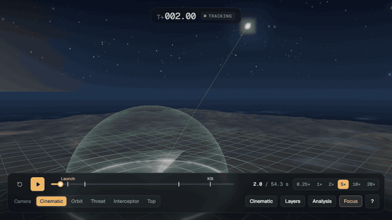
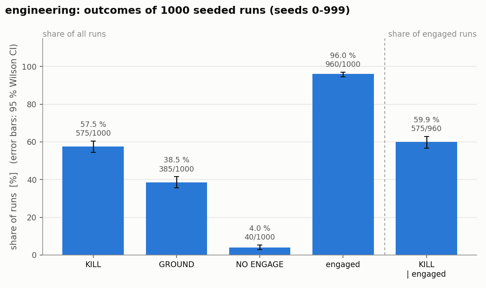
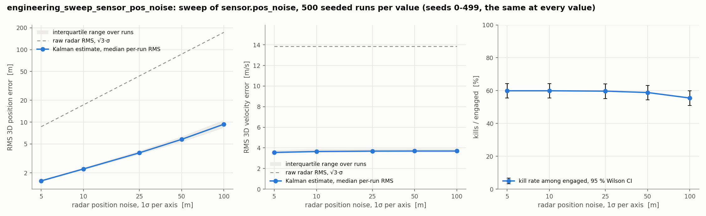
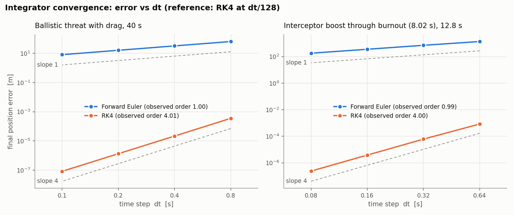
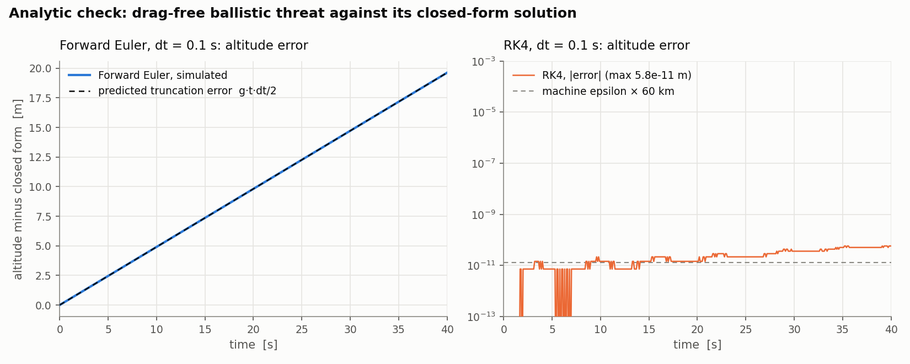
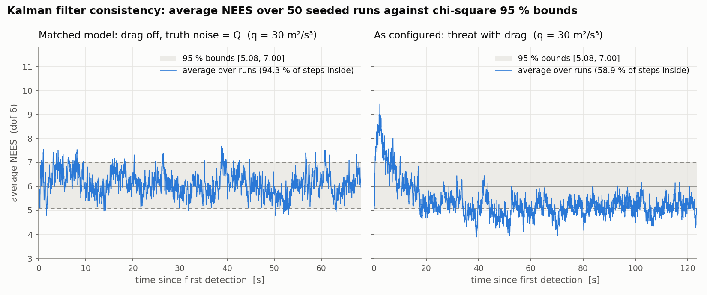

# THAAD-Style Terminal Intercept Simulation

A Python study of guidance, navigation and control for "hitting a bullet with a bullet", with a 3D replay in the browser.



**[Try it live](https://yehiagewily.github.io/THAAD-Simulation/)**: open a [3D replay](https://yehiagewily.github.io/THAAD-Simulation/replay.html) of an engagement, or the [batch results dashboard](https://yehiagewily.github.io/THAAD-Simulation/dashboard.html) over 1000 seeded runs. Nothing to install.

> ⚠️ An educational and hobby simulation. It models no real weapon system, and the numbers are illustrative, not real-world data.

---

## What it does

The code closes a simplified but complete engagement loop:

1. **Detection**: a radar-like sensor returns noisy 3D position and velocity of a ballistic threat.
2. **Estimation**: a 6-state Kalman filter tracks the threat.
3. **Decision**: fire control predicts the impact point (PIP) and launches only if it falls inside the defended area.
4. **Guidance**: augmented proportional navigation steers the interceptor.
5. **Physics**: a two-stage interceptor with mass flow from thrust and specific impulse, drag, gravity and a kill-vehicle divert budget, integrated with RK4.
6. **Assessment**: continuous closest-point-of-approach kill detection and a battle-damage summary.

Every run is a pure function of a YAML config and a seed, and opens as a self-contained HTML replay. [docs/methods.md](docs/methods.md) has the equations, assumptions, verification results and limitations.

## Quick start

You need Python 3.9 or newer. From the project folder:

```bash
pip install -e ".[dev]"
```

Run one engagement in engineering mode, the default and recommended mode:

```bash
python -m thaad_sim --config configs/engineering.yaml
```

The terminal prints the event log and a battle-damage table, and the replay opens in your browser. Each run prints its seed, and passing it back repeats the scenario exactly:

```bash
python -m thaad_sim --config configs/engineering.yaml --seed 913
```

| Option | Effect |
| --- | --- |
| `--seed N` | Replay a scenario; a run is fully determined by config and seed |
| `--out PATH` | Write the replay to `PATH` instead of `replays/replay_<timestamp>.html` |
| `--no-browser` | Write the replay without opening it |
| `--legacy-rng` | Draw random numbers like the old single-file scripts, so their printed seeds replay |

Replays are single HTML files with the viewer (including Three.js) built in, so they work offline and can be shared as-is. Only the fonts and the equation renderer in the Methods tab load from a CDN; offline, the equations show as source text.

### Modes

Both modes run the same code. Everything that differs lives in the YAML config.

| Config | Interceptor and threat | Launch rule | Kill rate, seeds 0–999 |
| --- | --- | --- | --- |
| `configs/engineering.yaml` | 150 kN for 5.0 s (Isp 170 s), 30 g, 435 m/s divert budget, 10 m kill radius; threats aimed up to 35 km off the defended point | PIP inside the 30 km defended radius after 5 s of track | **59.9 %** of engaged (575 / 960, 95 % CI 56.8–63.0 %) |
| `configs/demo.yaml` | 220 kN for 8.0 s (Isp 400 s), 50 g, unlimited divert, 30 m kill radius; easier threats aimed at the origin | Fire on a confirmed, descending track | **100 %** (1000 / 1000, 95 % CI 99.6–100 %) |

In engineering mode, interception is likely but not guaranteed: every one of the 385 misses had spent the kill vehicle's whole divert budget, and 40 threats predicted to land outside the defended area are not engaged (`NO ENGAGE`). The demo is for watching the geometry with a near-certain hit.

## The replay viewer

| Feature | |
| --- | --- |
| Scene | Terrain with the defended area and range rings, the PIP, radar returns, the Kalman track, the filter's 3σ uncertainty ellipsoid, and the line of sight |
| Timeline | Mission clock, a phase stepper (Track → Boost → Midcourse → Terminal → Kill/Impact) you can click to jump, scrubbing, and slow motion at the intercept |
| Telemetry | Threat, interceptor and engagement readouts, an event log, a side-profile chart, and a debrief card |
| Styles (`G`) | **Scientific**, the default: plain trajectories, drop lines, an altitude scale, a scale bar, an ENU axis triad and exact markers. **Cinematic**: glow, a cloud deck, smoke trails, a radar sweep and explosions |
| Analysis (`A`) | Synchronized figures for kinematics, guidance (LOS rate, commanded acceleration, divert Δv, zero-effort miss) and the Kalman filter (errors against ±3σ, raw against filtered), a Methods tab with every parameter of the run and the command to reproduce it, and **Export CSV** |

| Control | Action |
| --- | --- |
| `Space` | Play / pause |
| `←` / `→` (`Shift` for 5 s) | Step 1 s back / forward |
| `Home` / `End` | Jump to start / end |
| `1`–`6` | Playback speed 0.25× – 20× |
| `C` `O` `T` `I` `V` | Camera: cinematic, free orbit, chase threat, chase interceptor, top-down |
| `R` `K` `E` `L` `H` `M` | Toggle radar returns, Kalman track, track uncertainty (3σ), line of sight, labels, slow motion (also in the **Layers** menu) |
| `A` | Analysis panel |
| `G` | Scientific / cinematic style |
| `F` | Focus mode: hide the side panels |
| `?` | All keyboard shortcuts |
| Mouse | Drag to spin the camera, scroll to zoom, right-drag to pan. Grabbing a chase camera keeps orbiting that vehicle |

**Track uncertainty.** The `E` layer draws the Kalman filter's 3σ position ellipsoid. It is exaggerated 10× about the true threat position (the ellipsoid and the estimate's offset alike), so the threat sits inside the shell exactly when the estimate is within 3σ. With this Cartesian radar model the ellipsoid is a sphere, shrinking from 75 m to a few metres as the track converges. See [Methods §5](docs/methods.md#5-sensing-and-tracking).

**Deep links.** Add a hash to a replay's URL to open it at a given moment, for example `replay.html#t=40&cam=threat&paused`. `&focus` hides the panels, `&analysis&tab=kf` opens an Analysis tab (`kin`, `gui`, `kf`, `methods`), and `&style=cinematic` picks the cinematic look.

Vehicle models are drawn about 8× real size so they read in the close-up cameras.

## Batch runs and the dashboard

```bash
python -m thaad_sim.batch --config configs/engineering.yaml --n 1000 --seed 0
```

This runs N seeded engagements on all CPU cores without writing replays, and writes one CSV row per run to `results/<config name>.csv`: outcome, launch and kill times, kill altitude, closing velocity, closest approach, peak acceleration, divert Δv used, impact range and the filter's RMS errors. Run k uses seed `seed + k`, so any row can be replayed in the browser. The same seeds give the same file byte for byte, whatever the number of workers. `--sweep section.field=v1,v2,...` repeats the runs at each value of one config parameter.

```bash
python -m thaad_sim.dashboard results/engineering.csv --open
```

This writes `site/dashboard.html`, a self-contained page: outcome rates with 95 % Wilson intervals, histograms of every engagement metric, the Kalman filter consistency study and the integrator convergence study (read from `results/consistency.json` and `results/convergence.json`), each with a table view. [The live dashboard](https://yehiagewily.github.io/THAAD-Simulation/dashboard.html) is this page for the committed engineering CSV.

```bash
python scripts/summarize.py results/engineering.csv
```

This prints the same rates as a table and writes matplotlib figures to `docs/figures/`. It handles sweep CSVs too. It needs the `plot` extra: `pip install -e ".[plot]"`.

| Outcome (engineering, seeds 0–999) | k / n | Rate | 95 % Wilson CI |
| --- | --- | --- | --- |
| KILL | 575 / 1000 | 57.5 % | 54.4–60.5 % |
| GROUND | 385 / 1000 | 38.5 % | 35.5–41.6 % |
| NO ENGAGE | 40 / 1000 | 4.0 % | 3.0–5.4 % |
| engaged | 960 / 1000 | 96.0 % | 94.6–97.0 % |
| **KILL among engaged** | **575 / 960** | **59.9 %** | **56.8–63.0 %** |



Over a run, the filter's median RMS 3D error is 3.8 m in position and 3.7 m/s in velocity, against 43.3 m and 13.9 m/s for a single raw radar return. Sweeping the radar position noise from 5 to 100 m moves the kill rate by only 4.4 points: the interceptor misses because of its divert budget, not its track.



## Verification

The numerics, the filter and the statistics are checked against analytic results and against their own stated error models. The scripts below regenerate every figure and number. [Methods §7](docs/methods.md#7-verification) gives the details.

### Integrator convergence

At Δt, Δt/2, Δt/4 and Δt/8, the final-position error of each integrator against a much finer RK4 run falls at the method's formal order. That holds for the dragged threat and for the interceptor flying through burnout, whose step is split at the burnout instant.

| Problem | Observed order, Euler | Observed order, RK4 |
| --- | --- | --- |
| Ballistic threat with drag, 40 s | 1.00 | 4.01 |
| Interceptor boost through burnout, 12.8 s | 0.99 | 4.00 |



### Analytic tests

With drag off, the threat has a closed-form solution. RK4 reproduces it to 6×10⁻¹¹ m over 40 s, which is rounding. Forward Euler's altitude error equals its predicted truncation error g·t·Δt/2 to within 5×10⁻¹¹ m. The tests also check energy conservation, energy lost to drag against the drag work, the mass flow F/(Isp·g₀), booster separation, and the rocket-equation Δv.



### Kalman filter consistency (NEES and NIS)

For a consistent filter, the normalized estimation error squared (NEES) and the normalized innovation squared (NIS) are χ² with 6 degrees of freedom. Averaged over 50 runs, they must stay inside [5.08, 7.00] about 95 % of the time.

| Setting | Mean NEES | Inside bounds | Mean NIS | Inside bounds |
| --- | --- | --- | --- | --- |
| Matched model (drag off, truth driven by the filter's Q) | 6.11 | 94.3 % | 5.99 | 95.1 % |
| As configured (threat with drag) | 5.35 | 58.9 % | 5.92 | 94.6 % |

The filter is consistent with its own model. The real threat has drag, which the filter does not model: NEES reaches 8–9 in the first 15 s (overconfident), then settles near 5. The same mismatch biases the predicted impact point downrange by a median 1.7 km at 80 s to go and 3 m at 10 s ([Methods §7](docs/methods.md#drag-mismatch-in-the-impact-prediction)).



### Reproduce

```bash
pip install -e ".[dev,plot]"
```

```bash
python -m pytest
```

```bash
python scripts/convergence_study.py
```

```bash
python scripts/filter_consistency.py
```

```bash
python scripts/drag_mismatch.py
```

```bash
python scripts/palette_check.py
```

The test suite covers seeded determinism, agreement with the legacy scripts' outcomes, the integrators, the Kalman filter's algebra and its NEES/NIS consistency, the Wilson interval, byte-identical batch output, the replay and dashboard payloads, the built templates, and the palette checks. `convergence_study.py` writes `convergence.png`, `analytic.png` and `results/convergence.json`. `filter_consistency.py` writes `nees.png`, `nis.png` and `results/consistency.json` (about a minute). `palette_check.py` checks the viewer and dashboard colours for colour-vision deficiency and contrast in both rendering styles. GitHub Actions runs the tests on every push.

## Developing the viewer

The replay viewer and the dashboard are ES modules under `viewer/src/`. Vite builds each into a single self-contained HTML template under `thaad_sim/viewer/`, which the Python package fills with data. The built templates are committed, so running the simulation needs no Node. Rebuild after editing the viewer:

```bash
cd viewer && npm ci && npm run build
```

| Module | Contents |
| --- | --- |
| `replay/data.js` | Payload parsing, scene-unit conversion, interpolation, event times |
| `replay/scene.js` | Renderer, camera, sky, terrain, clouds, defended dome, reference geometry, 3D labels |
| `replay/models.js` | Threat, interceptor and spent-booster models |
| `replay/effects.js` | Trails, radar returns, explosions, line-of-sight lines |
| `replay/covariance.js` | The 3σ uncertainty ellipsoid |
| `replay/director.js` | Camera director for the directed cameras |
| `replay/charts.js`, `replay/analysis.js` | Figure engine, the Analysis drawer, Methods tab and CSV export |
| `replay/ui.js` | HUD, playback controls, keyboard shortcuts, styles |
| `replay/palette.js` | The colour palette, the single source for the scene, HUD and figures |
| `dashboard/` | The batch dashboard and its SVG charts |

`npm run dev` serves the sources with live reload, filled with the newest replay in `replays/` and the newest dashboard in `site/`. `node tools/check_views.mjs ../site/replay.html` opens a replay in headless Chrome, screenshots every camera in both styles, and checks every keyboard shortcut. `npm run record-gif` records the animation at the top of this page. CI checks that the committed templates match a fresh build.

The [GitHub Pages site](https://yehiagewily.github.io/THAAD-Simulation/) is built by `.github/workflows/pages.yml` on every push to `main`: one replay (engineering mode, seed 913), the dashboard, and the landing page in `docs/site/`.

## Project structure

```text
.
├── thaad_sim/                  # The simulation package
│   ├── __main__.py             # CLI: python -m thaad_sim --config ... --seed ...
│   ├── config.py               # SimConfig dataclasses, loaded from YAML
│   ├── dynamics.py             # Ballistic threat and two-stage interceptor
│   ├── integrators.py          # Forward Euler and RK4
│   ├── estimation.py           # 6-state Kalman filter
│   ├── guidance.py             # Proportional navigation, g-limit, divert budget
│   ├── scenario.py             # Random threat scenarios
│   ├── engagement.py           # Run loop, launch rule, CPA kill check, BDA
│   ├── batch.py                # python -m thaad_sim.batch: N seeded runs -> CSV
│   ├── dashboard.py            # python -m thaad_sim.dashboard: batch CSV -> HTML
│   ├── summary.py, stats.py    # Batch CSV loading, Wilson intervals
│   ├── consistency.py          # NEES/NIS and impact-prediction bias
│   ├── verification.py         # Reference problems for the integrator checks
│   ├── replay_viewer.py        # Packs a run into a replay
│   └── viewer/                 # Built HTML templates (from viewer/)
├── viewer/                     # Viewer and dashboard sources, Vite build, browser tools
├── configs/                    # engineering.yaml, demo.yaml
├── scripts/                    # Studies, summaries and the palette check
├── results/                    # Batch CSVs and study data behind every quoted number
├── docs/                       # methods.md, figures, the Pages landing page
├── tests/                      # pytest suite
└── older_attempts/             # Early scratch experiments, unused by the package
```

## Limitations

This is a sandbox for building intuition, not a predictive model. The model uses a flat Earth with constant gravity, constant-coefficient drag with no atmosphere model, an idealized Cartesian radar, and point-mass vehicles without attitude dynamics or a seeker. The filter and the impact predictor ignore the threat's drag, a mismatch that is measured, not corrected. [Methods §8](docs/methods.md#8-limitations) lists the limitations in full.

## Possible extensions

- Multiple simultaneous threats and interceptors.
- Other guidance laws (pure pursuit, true PN, impact-angle constraints).
- A range–azimuth–elevation radar with an update rate, clutter and missed detections. The uncertainty ellipsoid would then show its shape.
- Estimating drag in an extended Kalman filter, or predicting the impact point by integrating the dragged dynamics.
