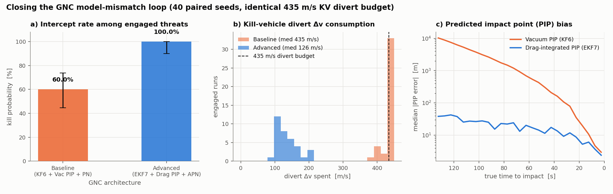
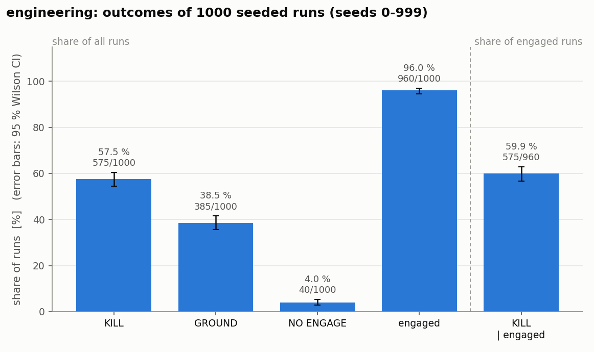
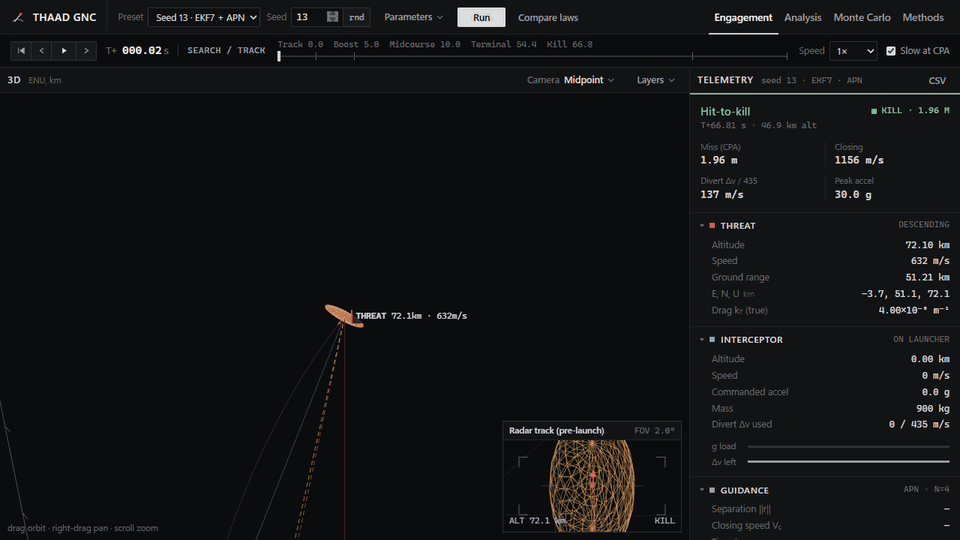

# THAAD-Style Terminal Intercept Simulation

[](https://doi.org/10.5281/zenodo.24208792)

A deterministic Python simulation of **terminal ballistic missile defense**—modeling radar sensing, Kalman state estimation, impact-point fire control, proportional/optimal guidance, and hit-to-kill two-stage vehicle dynamics.

> ⚠️ An educational and hobby simulation. It models no real weapon system, and all vehicle, sensor, and engagement numbers are illustrative.

---

## Documentation Map

| Guide | What's Inside |
| --- | --- |
| **Overview (this page)** | Simulation scope, closed-loop architecture, YAML modes, headline results, and repository map |
| **[How to Run](docs/running.md)** | Installation, CLI deterministic runs, multi-core Monte Carlo & `--sweep` campaigns, `--serve`, and `pytest` |
| **[Mathematical Model & Verification](docs/methods.md)** | Equations of motion, RK4 burnout splitting, KF6/EKF7, RAE covariance, PN/APN/ZEM laws, and NEES/NIS proofs |
| **[Viewer Characteristics](docs/visualizers.md)** | Live FastAPI Workstation (`--serve`), offline 3D HTML replays, batch dashboard, controls, and frontend architecture |

---

## What the Simulation Models

Every engagement runs a closed six-stage GNC loop over flat-Earth East–North–Up (ENU) coordinates, uniquely determined by a YAML config and a random seed:

1. **Detection** — Ballistic threat under quadratic drag; radar returns noisy measurements in `cartesian` coordinates or polar Range–Azimuth–Elevation (`rae`) with Doppler range-rate.
2. **Estimation** — Tracks the threat using a **6-state linear Kalman filter** (`kf6`, assuming vacuum free-fall) or a **7-state Extended Kalman Filter** (`ekf7`) that estimates the threat's ballistic drag coefficient $k_T$ in flight.
3. **Fire Control** — Predicts the threat's impact point (`vacuum` parabola or RK4 `drag` integration) and gates launch (`pip_gated` vs. `fire_on_track`) against the defended perimeter.
4. **Guidance & Control** — Commands lateral acceleration via **Classical PN** (`pn`), **Augmented PN** (`apn` with EKF drag feed-forward), or **Optimal ZEM** (`zem`), constrained by lateral $g$-limits, 1st-order actuator lag $\tau$, and a finite kill-vehicle divert $\Delta v$ budget.
5. **Physics & Integration** — Two-stage interceptor (booster with mass flow $F / (I_{sp} g_0)$, separation at burnout, kinetic kill vehicle) integrated with **RK4** (with exact burnout sub-step splitting) or Forward Euler.
6. **Kill Assessment** — Continuous chord closest-point-of-approach (CPA) intersection across kill radius $R_k$ and terminal Battle Damage Assessment.

See **[docs/methods.md](docs/methods.md)** for all governing equations, Jacobians, assumptions, and verification details.

---

## Modes & Key Engineering Insight

All scenarios run the exact same simulation code; only YAML settings change (`configs/`):

| Mode | Radar, Filter & Guidance | Interceptor Limits | Outcome Highlight |
| --- | --- | --- | --- |
| [`configs/engineering.yaml`](configs/engineering.yaml) | Cartesian radar, `kf6`, vacuum PIP, classical `pn` | 150 kN (5 s), 30 g, 435 m/s divert budget, 10 m $R_k$ | **59.9%** kill of engaged (575 / 960, 95% CI 56.8–63.0%); all 385 misses exhaust divert $\Delta v$ |
| [`configs/advanced.yaml`](configs/advanced.yaml) | Polar `rae` radar, `ekf7`, drag PIP, `apn` | Identical 150 kN (5 s), 30 g, 435 m/s divert, 10 m $R_k$ | Rescues divert-limited misses (e.g. **Seed 13**: 16.7 m miss $\to$ **1.96 m hit**, ~69% less $\Delta v$) |
| [`configs/demo.yaml`](configs/demo.yaml) | Cartesian radar, `kf6`, vacuum PIP, classical `pn` | 220 kN (8 s), 50 g, unlimited divert, 30 m $R_k$ | **100%** (1000 / 1000, 95% CI 99.6–100%) |

Sweeping radar noise from 5 m to 100 m shifts the engineering-mode kill rate by only 4.4 points—showing misses are **divert-budget limited**, not sensor-limited. Upgrading software alone (`ekf7` drag estimation + `drag` PIP + `apn`/`zem` guidance) removes the median 1.7 km vacuum PIP overshoot and cuts median KV divert $\Delta v$ usage by over 60%.





---

## Verification Snapshot

- **Integrator order** (`scripts/convergence_study.py`): Step-halving confirms order **1.00** (Euler) and **4.01** (RK4) on dragged threats, and **0.99** / **4.00** across interceptor booster burnout. With drag off, RK4 matches the closed-form solution to $6 \times 10^{-11}\text{ m}$.
- **Kalman consistency** (`scripts/filter_consistency.py`): Over 50 seeded runs, 6-DOF NEES/NIS stay inside the 95% $\chi^2$ interval $[5.08, 7.00]$ when matched (mean NEES **6.11**, **94.3%** inside; NIS **5.99**, **95.1%** inside), while `kf6` on a dragged threat drops to **58.9%** NEES coverage—quantifying the drag mismatch solved by `ekf7`.

---

## Quick Start

```bash
pip install -e ".[dev,plot,workstation]"

python -m thaad_sim --config configs/engineering.yaml --seed 13   # Single run -> offline 3D HTML replay
python -m thaad_sim --serve                                       # Live FastAPI GNC Workstation
python -m thaad_sim.batch --config configs/engineering.yaml --n 1000
python -m pytest
```

Full commands, sweep options, and study scripts: **[docs/running.md](docs/running.md)**.

---

## Visualization Layers

Two browser tools sit on top of `thaad_sim/` without altering the physics core (details in **[docs/visualizers.md](docs/visualizers.md)**):

- **Live Workstation (`--serve`)** — FastAPI server (`server.py`, `telemetry.py`, `workstation/`) running the real Python engine on demand for 3D inspection, optical seeker inset, 14 synchronized GNC/filter plots, 3-law comparisons, and multi-core live Monte Carlo batches.
- **Offline Replays & Batch Dashboard (`viewer/`)** — Zero-dependency single-file HTML exports (`replays/*.html`, `site/dashboard.html`) and the [GitHub Pages live demo](https://yehiagewily.github.io/THAAD-Simulation/).



---

## Project Structure

```text
.
├── thaad_sim/                  # Core Python simulation & GNC package
│   ├── __main__.py             # CLI entry point (--config, --seed, --serve)
│   ├── config.py               # YAML dataclasses (SimConfig)
│   ├── dynamics.py             # Ballistic threat & 2-stage interceptor ODEs
│   ├── integrators.py          # Forward Euler & RK4 (burnout sub-step splitting)
│   ├── estimation.py           # KF6, 7-state drag EKF7, RAE radar, vacuum/drag PIP
│   ├── guidance.py             # PN, APN, Optimal ZEM, g-limit, divert Δv budget
│   ├── scenario.py             # Seeded threat scenario generator
│   ├── engagement.py           # Closed-loop engagement runner, launch gate, CPA, BDA
│   ├── batch.py                # Multi-core Monte Carlo & --sweep runner -> CSV
│   ├── summary.py, stats.py    # Batch aggregation & Wilson confidence intervals
│   ├── consistency.py          # NEES, NIS & PIP bias diagnostics
│   ├── verification.py         # Step-halving & closed-form verification problems
│   ├── telemetry.py            # Vectorized telemetry builder for the workstation
│   ├── server.py               # FastAPI backend for the Live Workstation
│   ├── replay_viewer.py        # Self-contained HTML replay packer
│   ├── dashboard.py            # Self-contained HTML batch dashboard packer
│   ├── workstation/            # Live workstation frontend (HTML/CSS/ES modules)
│   └── viewer/                 # Compiled single-file HTML templates
├── configs/                    # engineering.yaml, advanced.yaml, demo.yaml
├── scripts/                    # Verification, GNC trade-off, envelope, & summary scripts
├── results/                    # Committed 1000-seed CSVs & verification JSONs
├── docs/                       # methods.md, running.md, visualizers.md, figures/, site/
├── viewer/                     # Source + Vite bundler for standalone HTML exports
├── tests/                      # pytest suite (physics, GNC, verification, API, templates)
└── older_attempts/             # Early prototype scripts (unused by thaad_sim)
```

---

## Limitations & Possible Extensions

Analytical point-mass sandbox: flat Earth with constant gravity, constant quadratic drag coefficient (no exponential atmosphere $\rho(z)$ or Mach $C_D(M)$ table), and no 6-DOF attitude or physical seeker gimbal dynamics ([docs/methods.md §8](docs/methods.md#8-limitations)).

**Possible extensions:** multi-target salvos (shoot-look-shoot fire control), US Standard Atmosphere $\rho(z)$ and Mach drag curves $C_D(M)$, and 6-DOF rigid-body dynamics with strapdown/gimballed terminal IR seeker tracking.

---

## License & Citation

Released under the [MIT License](LICENSE). If you use this software in research or teaching, please cite it via [CITATION.cff](CITATION.cff) (GitHub's "Cite this repository" button).
