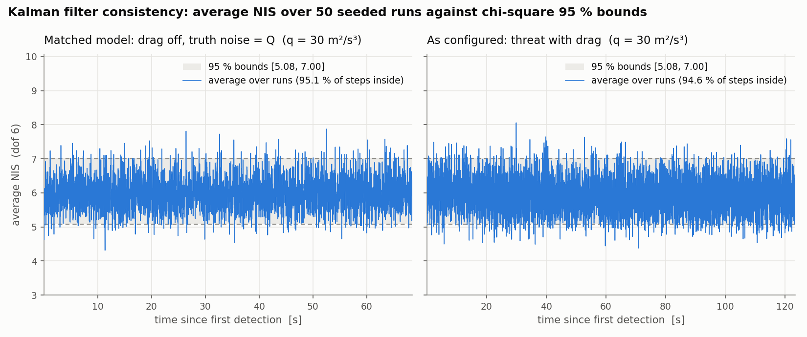
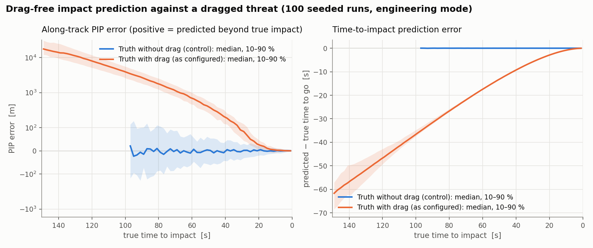

# THAAD-Like Ballistic Missile Defense Simulation

A Python-based study of Guidance, Navigation, and Control (GNC) for kinetic interception

---

## Overview

This project is a 3D kinematic simulation of a **THAAD-style terminal missile defense system**, built in Python using NumPy and Rich, with a Three.js replay viewer in the browser.

The goal is **not** to model any real weapon system, but to:

* Deconstruct the maths and physics behind **"hitting a bullet with another bullet"**.
* Explore core **Guidance, Navigation, and Control (GNC)** concepts.
* Visualize how a defensive interceptor reacts to an incoming ballistic threat under noisy sensing, drag, gravity, and staging.

Instead of being just an animation, the code closes a simplified but complete **GNC loop**:

1. **Detection** – radar-like noisy measurements of a ballistic threat in 3D.
2. **Estimation** – a 6‑state Kalman Filter estimating true position and velocity.
3. **Decision** – fire-control logic determining *if and when* to launch based on predicted impact.
4. **Guidance** – Augmented Proportional Navigation (APN) steering the interceptor.
5. **Physics** – multi-stage interceptor dynamics, mass depletion, drag, and gravity.
6. **Engagement Assessment** – continuous collision detection (CPA) and a battle-damage summary.

All of this is visualized in an interactive **3D browser replay** (Three.js) with cinematic cameras, a timeline, live telemetry, and a **Rich-based BDA table** in the terminal.

> ⚠️ This is an educational / hobby simulation. Numbers are illustrative, not real-world data.

---

## Project Structure

From the repository root:

```text
.
├── thaad_sim/                  # The simulation package
│   ├── __main__.py             # CLI: python -m thaad_sim --config ... --seed ...
│   ├── config.py               # SimConfig dataclasses, loaded from YAML
│   ├── dynamics.py             # Ballistic threat and two-stage interceptor
│   ├── integrators.py          # integrate(state, deriv_fn, dt): forward Euler and RK4
│   ├── verification.py         # Reference problems for the integrator tests and study
│   ├── estimation.py           # 6-state Kalman filter
│   ├── consistency.py          # NEES/NIS and impact-prediction bias over seeded tracking runs
│   ├── guidance.py             # Proportional navigation, g-limit, divert budget
│   ├── scenario.py             # Random threat scenarios
│   ├── engagement.py           # Run loop, launch rule, CPA kill check, outcome and BDA
│   ├── replay_viewer.py        # Packs a finished run into a browser replay
│   └── viewer/replay_template.html  # Three.js replay viewer
├── configs/
│   ├── engineering.yaml        # Engineering mode (tuned realism)
│   └── demo.yaml               # Max-performance demo
├── tests/                      # pytest suite
├── scripts/
│   ├── convergence_study.py    # Error vs dt for both integrators
│   ├── filter_consistency.py   # Average NEES/NIS against chi-square bounds
│   └── drag_mismatch.py        # Impact-prediction bias from ignoring drag
├── docs/figures/               # Generated figures (convergence, nees, nis, pip_bias)
├── replays/                    # Generated replays (git-ignored)
├── older_attempts/             # Scratch & learning experiments
├── pyproject.toml
└── README.md
```

Both modes run the same code. Everything that differs between them lives in the YAML config: the integrator (`sim.integrator`: `rk4`, the default, or `euler`), the interceptor's numbers, whether the kill vehicle has a divert budget (`interceptor.kv_divert_dv`, `null` for unlimited), the launch rule (`engagement.launch_rule`: `pip_gated` or `fire_on_track`), and the scenario ranges (`scenario.*`, with `aim_radius: null` aiming every threat at the origin).

### Modes

#### `configs/engineering.yaml` – Engineering Mode (Tuned Realism)

This is the **primary** mode and the CLI default.

* Uses randomized threat geometry (55–75 km altitude, 35–55 km range, any azimuth) with the aim point scattered up to 35 km from the defended origin.
* Simulates a two-stage interceptor with moderate thrust (150 kN at an Isp of 170 s, which burns its 450 kg of propellant in 5.0 s), a 30 G limit, and a kill vehicle with a finite **divert Δv budget** (435 m/s).
* Tracks the threat with a 6-state Kalman filter (gravity as a control input, white-noise acceleration process noise).
* Computes a **Predicted Impact Point (PIP)** and launches only when:

  * The threat is clearly descending.
  * The track has been observed long enough to be stable (`min_track_time`, 5 s).
  * The PIP lies inside the defended area (`defended_radius`, 30 km). Threats predicted to land outside it are not engaged (`NO ENGAGE`).
* Uses continuous collision detection and a tight 10 m kill radius.

Result: **interception is likely but not guaranteed.** Over 300 seeded runs (seeds 0–299), about 60% of engaged threats are killed; the rest exhaust the kill vehicle's divert fuel and miss, and about 4% are held fire because they land outside the defended area.

#### `configs/demo.yaml` – Max-Performance Intercept Demo

This mode runs the same code (Kalman, PN guidance, CPA, 3D replay) with more aggressive tuning:

* Easier threat profiles (40–60 km altitude, 25–40 km range, always aimed at the origin, with mild drag compensation).
* Stronger interceptor (220 kN at an Isp of 400 s, an 8.0 s burn, 50 G limit, 30 m kill radius, unlimited divert fuel).
* Launches as soon as the track is confirmed (3 s) and the threat is descending, without a PIP check.

Result: **high probability of intercept** (300/300 seeded runs, seeds 0–299), visually satisfying trajectories, and big closing velocities. Use this mode for demonstrations or when you want a near-guaranteed hit to study the geometry.

### Older Attempts / Scratch Files

The `older_attempts/` folder holds **scratch and learning experiments**. They were used to:

* Test basic ballistic motion and drag.
* Prototype simple PN interceptors.
* Play with Matplotlib 3D visualization and animation.

They are kept for historical context and are not used by the `thaad_sim` package.

---

## Quick Start

### 1. Install

You need Python 3.9+. From the project folder:

```bash
pip install -e ".[dev]"
```

This installs numpy, rich and pyyaml, plus pytest for the tests. The 3D replay runs in your web browser and loads Three.js from a CDN, so the first run needs an internet connection.

### 2. Run the engineering mode (recommended)

```bash
python -m thaad_sim --config configs/engineering.yaml
```

### 3. Run the max-performance demo

```bash
python -m thaad_sim --config configs/demo.yaml
```

Each run uses a random seed and prints it. A run is a pure function of the config and the seed, so passing the seed repeats the scenario exactly:

```bash
python -m thaad_sim --config configs/engineering.yaml --seed 123
```

Other options:

* `--no-browser` writes the replay file without opening it.
* `--legacy-rng` draws random numbers the way the old single-file scripts (`THAAD Ultimlate Prototype.py`, `THAAD MAX_performance prototype.py`) did, so a seed they printed replays the same scenario. Without it, the same seed number gives a different scenario.

### 4. Run the tests

```bash
python -m pytest
```

The suite checks that a fixed seed gives identical runs, that the package matches the outcome and kill time (within 0.25 s) the old scripts produced for a set of recorded seeds (`tests/data/legacy_baselines.json`), the CPA function, config loading, and the CLI. It also verifies the numerics (`tests/test_integrators.py`):

* With drag off, RK4 matches the closed-form ballistic solution to rounding, and forward Euler's error is exactly its truncation error, g·t·dt/2 in altitude.
* With drag off, RK4 conserves energy; with drag on, the energy lost equals the drag work ∫k‖v‖³dt.
* At dt, dt/2, dt/4 and dt/8 the observed convergence order is about 1 for Euler and about 4 for RK4, for both the dragged threat and an interceptor flying through burnout.
* The interceptor's mass falls at F/(Isp·g₀), the booster separates at burnout, and the burn adds the rocket-equation Δv.

The Kalman filter tests (`tests/test_estimation.py`) check:

* The discretized Q matches the white-noise acceleration integral, and F x + B u propagates a drag-free ballistic state exactly.
* The gain from the linear solve and the Joseph-form update match the textbook forms.
* P stays symmetric positive definite through a whole dragged flight, for q = 0, 30 and 10⁴.
* With drag off and the truth driven by the filter's own Q, the 20-run average NEES and NIS stay inside their chi-square 95 % bounds, and the same check rejects a q that is wrong by a factor of 5.
* The documented drag mismatch: the filter that passes with drag off fails with drag on, and the drag-free PIP lands beyond the true impact point.

GitHub Actions runs the suite on every push and pull request.

### 5. Convergence study

```bash
pip install -e ".[plot]"
```

```bash
python scripts/convergence_study.py
```

This runs the same reference problems and writes a log-log plot of error against dt for both integrators, with slope-1 and slope-4 reference lines, to `docs/figures/convergence.png`:


### 6. Filter consistency and drag-mismatch studies

```bash
python scripts/filter_consistency.py
```

```bash
python scripts/drag_mismatch.py
```

The first runs 50 seeded tracking runs and writes the average NEES and NIS against their chi-square bounds to `docs/figures/nees.png` and `nis.png`. The second runs 100 and writes the impact-prediction bias to `docs/figures/pip_bias.png`. Both take about a minute. [Radar Model & Kalman Filtering](#radar-model--kalman-filtering) discusses the results.

### 7. Watch the replay

When the run finishes, the terminal prints Rich logs with launch events, kill / fail messages, and a final BDA table. The engagement then opens in your browser as a 3D replay, saved to `replays/replay_<timestamp>.html` under the current folder.

The replay includes:

* Terrain with the defended area, range rings, the predicted impact point (PIP), radar returns, the Kalman track, and the line of sight.
* A mission clock with a phase stepper (Track → Boost → Midcourse → Terminal → Kill/Impact). Click a phase to jump to it.
* Live telemetry, including the track's 1σ uncertainty and its error against the truth. The panels also hold an event log, a side-profile chart, and a debrief card after the engagement.
* Two rendering styles (`G` switches between them):
  * **Scientific** (the default): plain trajectories, drop lines to the ground, an altitude scale at the battery, a scale bar and an east–north–up axis triad, and exact intercept and impact markers. Ground axis labels show in the top-down view.
  * **Cinematic**: glow, a cloud deck, smoke trails, a radar sweep, and explosion effects.
* An **Analysis** panel (`A`):
  * **Kinematics**: altitude, speed, separation, and closing velocity.
  * **Guidance**: line-of-sight rate, commanded acceleration against its limit, divert Δv used against its budget, and zero-effort miss.
  * **Kalman filter**: RMS errors, noise reduction, 3σ consistency, per-axis position error with ±3σ bounds, and filtered versus raw radar error.
  * **Methods**: the model equations, every parameter used in the run, assumptions, and the command to reproduce the run.
  * All figures share the replay's time cursor. Hover for values and click to seek. **Export CSV** downloads the full time series.

| Control | Action |
| --- | --- |
| `Space` | Play / pause |
| `←` / `→` (`Shift` for 5 s) | Step 1 s back / forward |
| `Home` / `End` | Jump to start / end |
| `1`–`6` | Playback speed 0.25× – 20× |
| `C` `O` `T` `I` `V` | Camera: cinematic, free orbit, chase threat, chase interceptor, top-down |
| `R` `K` `L` `H` `M` | Toggle radar returns, Kalman track, line of sight, labels, slow motion at intercept (also in the **Layers** menu) |
| `A` | Open / close the Analysis panel |
| `G` | Switch between Scientific and Cinematic style |
| `F` | Focus mode: hide the side panels |
| `?` | Show all keyboard shortcuts |
| Mouse | Drag in any view to spin the camera, scroll to zoom, right-drag to pan. Grabbing a chase camera keeps orbiting that vehicle as it flies; `C`/`T`/`I`/`V` hand the camera back |

To open a replay at a given moment, add a hash to the file URL, for example `replay_….html#t=57&cam=threat&paused`. Add `&focus` to hide the panels, `&analysis&tab=kf` to open a given Analysis tab (`kin`, `gui`, `kf`, `methods`), or `&style=cinematic` for the cinematic look.

Vehicle models are drawn about 8× real size so they can be seen in the close-up cameras.

---

## How the Simulation Works

### Coordinate System & Units

* Right-handed Cartesian coordinates:

  * **x** – East (meters)
  * **y** – North (meters)
  * **z** – Altitude above defended ground plane (meters)
* **z = 0** represents ground level / defended plane.
* Time is in **seconds**; velocities in **m/s**; accelerations in **m/s²**.
* Gravity is constant: `g = 9.81 m/s²`.

Earth curvature, rotation, and detailed atmosphere models are ignored, which is acceptable for terminal engagements on the order of tens of kilometers.

---

### Numerical Integration

Each body keeps its state in one array and advances it with a single function, `integrate(state, deriv_fn, dt, method)` in `thaad_sim/integrators.py`:

* Threat state: `[x, y, z, vx, vy, vz]`.
* Interceptor state: `[x, y, z, vx, vy, vz, m]`, so the interceptor's mass is integrated together with its motion.

`deriv_fn` returns dx/dt for the body's equations of motion. Two methods are available, chosen by `sim.integrator` in the config:

* **`rk4`** (the default): classical fourth-order Runge–Kutta.

  > k1 = f(x), k2 = f(x + dt/2·k1), k3 = f(x + dt/2·k2), k4 = f(x + dt·k3)
  >
  > x ← x + dt/6 · (k1 + 2k2 + 2k3 + k4)

  The global error falls as dt⁴.
* **`euler`**: forward Euler, `x ← x + dt·f(x)`. The global error falls as dt.

Inputs that are not part of the state are held constant over a step. Guidance runs once per step at a fixed rate, as a flight computer would, and its command is held over the step. Burnout is a discontinuity, since thrust stops and the booster separates. The step that contains it is split at the burnout time, so the cutoff happens at the right instant and RK4 keeps its fourth order. The convergence study and `tests/test_integrators.py` measure these orders.

**Behavior change.** Before the `integrate()` abstraction, both bodies used semi-implicit Euler, and interceptor mass followed a fixed linear ramp over a configured `boost_time`. Now:

* The default integrator is RK4.
* `boost_time` is replaced by `isp`. Each mode's Isp gives nearly the same burn time and total impulse as before: 5.00 s instead of 5 s for engineering, 8.02 s instead of 8 s for the demo.

So a given seed flies a slightly different trajectory than before. The scenario and the sensor noise are unchanged, and the recorded legacy seeds keep their outcomes, with kill times within 0.25 s. Over seeds 0–299 the engineering mode then killed 174 of 289 engaged threats, down from 175, and still held fire on 11; the demo still killed 300/300. (The Kalman filter rework below changed these numbers again.)

---

### Radar Model & Kalman Filtering

The radar is modeled as a noisy 3D sensor: 

* True position: **p = (x, y, z)**
* True velocity: **v = (vx, vy, vz)**
* Measurements:

> p_meas = p + N(0, σp²)
>
> v_meas = v + N(0, σv²)

A **linear Kalman filter** (`thaad_sim/estimation.py`) estimates the state x = [x, y, z, vx, vy, vz]ᵀ. It models the threat as a body under known gravity, perturbed by continuous white-noise acceleration:

> x_{k+1} = F x_k + B u + w_k,  w_k ~ N(0, Q)
>
> z_k = H x_k + v_k,  v_k ~ N(0, R)

with

> F = [[I, Δt·I], [0, I]],  B = [[½Δt²·I], [Δt·I]],  u = [0, 0, −g]
>
> H = I,  R = diag(σp²·I, σv²·I)

Gravity enters as a known control input, B u, so it moves both the predicted position and the predicted velocity.

**Process noise.** `kalman.q` (m²/s³) is the power spectral density of the white acceleration noise on each axis. Integrating it over one step gives, per axis,

> Q = q · [[Δt³/3, Δt²/2], [Δt²/2, Δt]]

**Update.**

> S = H P⁻ Hᵀ + R,  K = P⁻ Hᵀ S⁻¹
>
> x = x⁻ + K ν,  ν = z − H x⁻
>
> P = (I − K H) P⁻ (I − K H)ᵀ + K R Kᵀ

K comes from `np.linalg.solve` with S, not an explicit inverse. The Joseph-form covariance update keeps P symmetric and positive definite for any gain, which the short form (I − K H) P⁻ does not guarantee under rounding. The first measurement initializes the state with P₀ = R, the exact covariance of that estimate since H = I.

**Behavior change.** The filter used to subtract g·Δt from vz in place, add Q = 0.1·I every step and start from P₀ = 500·I. With the new filter and q = 30 m²/s³, the recorded legacy seeds keep their outcomes, with kill times within 0.25 s. Over seeds 0–299 the engineering mode kills 178 of 289 engaged threats, up from 174, and still holds fire on 11. The demo still kills 300/300.

#### Consistency: NEES and NIS

Two statistics check whether the filter's covariance describes its actual errors:

> NEES  ε = (x̂ − x)ᵀ P⁻¹ (x̂ − x)
>
> NIS  ε_ν = νᵀ S⁻¹ ν

For a consistent filter both are chi-square with 6 degrees of freedom, with mean 6. Averaged over N independent runs, N times the average is chi-square with 6N degrees of freedom, which gives 95 % bounds of [5.08, 7.00] for N = 50. `scripts/filter_consistency.py` runs 50 seeded tracking runs in two settings:

* **Matched model** (left panels): drag off, and the truth driven by noise drawn from the filter's own Q, so the filter's model is exact. The average NEES is 6.11, with 94.3 % of steps inside the bounds. The average NIS is 5.99, with 95.1 % inside. The filter is consistent.
* **As configured** (right panels): the real threat, which has drag. The average NEES over the whole flight is 5.35, but only 58.9 % of steps are inside. NEES is about 8–9 in the first 15 s, while the threat is fastest and drag is strongest, so the filter is overconfident there. Later it settles near 5, mildly conservative. A single constant q cannot match an unmodeled acceleration that changes this much over the flight.




NIS stays inside its bounds in both settings (94.6 % with drag). Because the radar measures velocity directly, the innovations are dominated by R, so NIS hardly reacts to an error in Q. NEES needs the truth, so it only exists in simulation, but it is the sharper test here.

**Choice of q.** For the drag-free model, the right q is the one that matches the truth's noise; the threat has none, so that q would be small. Such a filter is badly overconfident against the dragged threat: with q = 1 m²/s³ the average NEES over the first 30 s is about 200. q = 30 m²/s³ covers the drag on average. Of the values swept (1, 10, 30, 100, 300), it also gave the most kills over seeds 0–299: 163, 175, 178, 177 and 171 respectively.

#### Model mismatch: drag

The truth threat has quadratic drag, but the filter and the impact predictor assume drag-free flight. The mismatch is not corrected. It is measured and documented here.

The predictor solves z(t) = 0 for drag-free ballistic motion from the current estimate, and extrapolates the horizontal position with the current velocity:

```python
def predict_impact(self, g):
    # t* = (vz + sqrt(vz^2 + 2 g z)) / g,  PIP = (x + vx t*, y + vy t*)
```

`scripts/drag_mismatch.py` tracks 100 seeded engineering-mode threats twice, once with drag (as configured) and once without (the control). It compares the predicted impact point and the predicted time to impact with the true ground crossing, binned by the true time to go:

| True time to go | Along-track PIP error (median) | Time-to-impact error (median) |
| --- | --- | --- |
| 100 s | +3.8 km | −36 s |
| 80 s | +1.7 km | −26 s |
| 60 s | +660 m | −17 s |
| 40 s | +185 m | −8.9 s |
| 20 s | +23 m | −2.7 s |
| 10 s | +3 m | −0.7 s |

In the control, the median along-track error stays within ±10 m from 80 s to go onward, and the time-to-impact error is under 0.01 s. In both cases the median cross-track error is under 10 m.



* **Direction.** Drag slows the threat, so extrapolating its current velocity without drag carries it further and brings it down sooner than it really will. The PIP therefore lies downrange of the true impact point, and the predicted time to impact is too short. Drag acts along the velocity, so the bias is almost entirely along-track.
* **Size.** The bias grows with the remaining flight time. It is about 20 km early in the flight, about 1.7 km at 80 s to go and a few metres in the last 10 s. The control shows that the predictor is unbiased when its model is right, so the bias comes from the prediction model, not from the state estimate.
* **Effect on the launch decision.** At the first launch opportunity (5 s of track, a median 143 s before impact), the PIP is a median 18 km from the true impact point. In 12 of 100 runs the PIP gate would launch at a threat that lands outside the defended area. In 1 it would hold fire on a threat that lands inside, until the PIP drifts inside on a later step. The control has no wrong calls.
* **Effect on the replay.** The PIP marker in the replay is this drag-free prediction, so it converges on the true impact point only late in the flight.
* **No direct effect on guidance.** Proportional navigation steers on the current estimate, not on the predicted impact point.

The drag model itself exaggerates the effect. The drag coefficient is constant with no air-density model, so drag acts at full strength even at 70 km altitude. A dragged threat takes 1.5 to 2 times its nominal flight time to land (median 1.7 over 100 seeds). Two fixes are possible but not implemented. One is to add a ballistic coefficient to the state and estimate it with an extended Kalman filter. The other is to predict the impact by integrating the dragged dynamics forward from the estimate.

---

### Threat Model – Ballistic Target

The incoming warhead is approximated as a **point mass** with gravity and a simple drag term:

`a_threat = [0, 0, -g] - C_d * ||v|| * v`

Each run spawns a new random scenario:

* Initial altitude z0 in the tens of kilometres (e.g. 50–70 km).
* Initial ground range r0 tens of kilometres away from the origin.
* Random azimuth angle so the threat can arrive from any direction.

To ensure it actually aims near the defended origin, the code:

1. Chooses a nominal time-to-impact T_imp.
2. Solves the 1D vertical ballistic equation (constant gravity, no drag) for v_z0 such that z(T_imp) ≈ 0.
3. Solves for v_x0 and v_y0 so that after T_imp the footprint is roughly at (0, 0).
4. Multiplies the whole velocity vector by a small drag compensation factor so that with drag, the trajectory still ends near the defended region.

This produces a variety of realistic-looking terminal threat trajectories.

---

### Interceptor Model – Two-Stage Vehicle

The interceptor is modeled as a two-stage vehicle:

1. **BOOST stage**

   * Constant thrust magnitude (`boost_thrust`) with a specific impulse (`isp`).
   * The propellant mass flow follows from thrust and Isp, ṁ = F / (Isp · g₀) with g₀ = 9.80665 m/s². Mass is a state variable integrated with dm/dt = −ṁ.
   * The burn lasts until the propellant (`mass_wet − mass_dry`) is spent, so the burn time is derived rather than configured: t_b = (mass_wet − mass_dry) · Isp · g₀ / F.
   * Drag uses a "booster" coefficient.
   * Maneuver commands are partially applied (e.g. 10%) on top of thrust to mimic limited thrust-vectoring.

2. **KV_COAST stage**

   * At burnout the booster separates and the mass state jumps to `kv_mass`.
   * No main thrust (pure coast).
   * Drag uses a separate smaller `kv_drag` coefficient.
   * Maneuver commands represent kill-vehicle divert thrusters. The divert budget is a Δv limit (`kv_divert_dv`). The kill vehicle's mass stays at `kv_mass`, because divert propellant is not modeled.

Internally, the forces on the interceptor are:

> F_total = F_thrust + F_grav + F_drag + F_maneuver

and acceleration is a = F_total / m, with m taken from the integrated state. With gravity and drag off, the burn reproduces the rocket equation, Δv = Isp · g₀ · ln(mass_wet / mass_dry), and a test checks this.

---

### Guidance – Augmented Proportional Navigation (APN)

The interceptor uses a classic **Proportional Navigation (PN)** guidance law with gravity compensation.

1- Compute relative vectors:

> r = p_target - p_interceptor
>
> v = v_target - v_interceptor

2- Line-of-sight (LOS) rotation rate:

> omega = (r × v) / (|r|² + ε)

3- PN acceleration command:

> a_PN = N * (v × omega)

4- Augment with gravity bias:

> a_cmd = a_PN + [0, 0, g]

5- Enforce a **G-limit**:

> |a_cmd| ≤ max_g * g

If the commanded acceleration exceeds the allowed limit, it is scaled back. The final command is logged as a G-load history for post-mission analysis.

Intuition:

* If the LOS is not rotating, the interceptor is already on a collision course.
* LOS rotation triggers lateral acceleration to drive LOS rate back toward zero.

---

### Continuous Collision Detection (CPA)

At typical closing speeds (several km/s), the threat and interceptor can move **tens of meters per time step**. A naive check like:

```python
if np.linalg.norm(threat.pos - interceptor.pos) < kill_radius:
    # hit
```

would miss collisions because the objects may "jump over" each other between frames.

To fix this, the simulation uses **Closest Point of Approach (CPA)** over each time step:

1- Both bodies are first propagated over the same step, from t to t + dt, by the configured integrator. Using their positions at t, let Δp = p2 - p1, and Δv = v2 - v1, where each v is that body's displacement over the step divided by dt. The check therefore uses the chord between the integrator's step endpoints, and works the same for RK4 and Euler. The chord departs from the curved path by at most a·dt²/8, about 1.5 cm at 30 G and dt = 0.02 s.
2- The time of minimum separation (assuming linear motion over the step) is:

> t_min = - (Δp · Δv) / |Δv|²

3- If 0 ≤ t_min ≤ dt, the distance at that instant is checked; otherwise, the distances at the start and end of the step are compared.

If the minimum distance within the step is smaller than `kill_radius`, the sim:

* Marks a **HIT** outcome.
* Computes the precise collision time and positions.
* Places a bright explosion marker at that point in 3D.

---

### Battle Damage Assessment (BDA)

At the end of each run, the terminal prints a **Rich** table summarising the engagement, for example:

```text
┏━━━━━━━━━━━━━━━━━━━━━━━━━━┓
┃ BATTLE DAMAGE ASSESSMENT ┃
┡━━━━━━━━━━━━━━━━━━━━━━━━━━┩
│ Outcome      │ KILL       │
│ Kill Alt     │ 42.5 km    │
│ Miss Dist    │ 0.12 m     │
│ Closing Vel  │ 3100 m/s   │
│ Max G-Load   │ 12.4 G     │
└──────────────────────────┘
```

Possible outcomes:

* `KILL` – interceptor successfully hits the threat within the kill radius.
* `GROUND` – threat impacts the ground (z = 0) before intercept.
* `NO ENGAGE` – (`pip_gated` launch rule only, i.e. Engineering Mode) the PIP was never inside the defended area, so no interceptor was launched and the threat landed outside it.
* `TIMEOUT` – simulation time ends while the threat is still airborne and not yet killed.

The BDA values and the 3D replay complement each other, providing both **numbers** and **geometry**.

---

## Modes Summary

| Config                     | Style            | Intercept Guarantee | Notes                                                                               |
| -------------------------- | ---------------- | ------------------- | ----------------------------------------------------------------------------------- |
| `configs/engineering.yaml` | Engineering Mode | ~60% of engaged     | Moderate thrust, 30 G, finite divert Δv, 10 m kill radius, PIP-gated launch.       |
| `configs/demo.yaml`        | Max-Performance  | ~100%               | Strong interceptor, easier threat, launches on track confirmation; good for demos. |

Both modes share the same core ideas: Kalman tracking, APN guidance, continuous collision detection, and 3D visualisation.

---

## ⚠️ Limitations & Assumptions

This is a **learning tool**, not a design or validation environment. Major simplifications include:

* **Aerodynamics** – drag is a simple constant-coefficient model; no Mach dependence, no atmosphere layering.
* **Estimation model mismatch** – the Kalman filter and the impact predictor assume drag-free flight, while the threat has drag. The predicted impact point is biased downrange, and the filter is overconfident early in the flight (see [Model mismatch: drag](#model-mismatch-drag)).
* **Propulsion** – constant thrust and Isp, with no pressure or altitude dependence. The kill vehicle's divert budget is a Δv limit, not a propellant mass.
* **Guidance timing** – the guidance command is held constant over each step. The closed engagement loop therefore converges at first order in dt whatever the integrator, while the vehicle dynamics between commands are integrated at the integrator's order.
* **Earth Model** – flat Earth with constant gravity; no curvature, rotation, or Coriolis effects.
* **Sensors** – radar is treated as a perfect 3D position/velocity sensor with Gaussian noise; real systems work in range/angle space, with clutter, dropouts, and fusion from multiple sensors.
* **Guidance** – classic PN with a simple gravity bias; real guidance laws include many more constraints and details.
* **No classification** – all parameters are chosen for nice behaviour and readability, not based on any sensitive or proprietary data.

Treat this repository as a **sandbox for building intuition** about missile defence kinematics, not a predictive model for any real system.

---

## Possible Extensions

Some ideas for future work:

* Multiple simultaneous threats and interceptors.
* Different guidance laws (pure pursuit, augmented PN variants, impact-angle constraints).
* More realistic radar models (range/azimuth/elevation, update rate, clutter, missed detections).
* Batch Monte Carlo runs to gather statistics on the probability of kill vs. configuration.
* Estimate drag in the filter (a ballistic coefficient in an extended Kalman filter), or predict the impact point by integrating the dragged dynamics.
* Simple GUI front-end to build scenario configs.

---
