# Methods

A short technical description of what the simulation computes, how it was verified, and where it stops being a good model. Parameter values are those of `configs/engineering.yaml` unless noted; `configs/demo.yaml` uses the same equations with different numbers.

> Educational simulation. The parameters are chosen to make the dynamics visible and are not data for any real system.

## 1. Frame, state and integration

The frame is flat-Earth east–north–up: $x$ east, $y$ north, $z$ up, in SI units, with the defended point at the origin and constant gravity $g = 9.81\ \mathrm{m/s^2}$.

Each body is a point mass whose state is advanced as one first-order system $\dot{\mathbf x} = f(\mathbf x)$:

| Body | State |
| --- | --- |
| Threat | $[\mathbf r, \mathbf v]$, 6 values |
| Interceptor | $[\mathbf r, \mathbf v, m]$, 7 values, so mass is integrated with the motion |

`sim.integrator` selects classical fourth-order Runge–Kutta (default) or forward Euler, at $\Delta t = 0.02$ s:

$$
\mathbf k_1 = f(\mathbf x_n),\quad
\mathbf k_2 = f\!\left(\mathbf x_n + \tfrac{\Delta t}{2}\mathbf k_1\right),\quad
\mathbf k_3 = f\!\left(\mathbf x_n + \tfrac{\Delta t}{2}\mathbf k_2\right),\quad
\mathbf k_4 = f(\mathbf x_n + \Delta t\,\mathbf k_3),
$$

$$
\mathbf x_{n+1} = \mathbf x_n + \tfrac{\Delta t}{6}\left(\mathbf k_1 + 2\mathbf k_2 + 2\mathbf k_3 + \mathbf k_4\right).
$$

Inputs that are not part of the state (the guidance command) are held constant over a step. Burnout is a discontinuity, so the step that contains it is split at the burnout time.

## 2. Threat

A point mass under gravity and quadratic drag with a constant coefficient $k_T = 4\times10^{-5}\ \mathrm{m^{-1}}$:

$$
\ddot{\mathbf r}_T = -g\,\hat{\mathbf z} - k_T\,\lVert\dot{\mathbf r}_T\rVert\,\dot{\mathbf r}_T .
$$

Each scenario draws a nominal time to impact $T$ (70–100 s), an initial altitude $z_0$ (55–75 km), a ground range (35–55 km) at a random azimuth, and an aim point up to 35 km from the origin. The initial velocity is the vacuum ballistic solution that reaches the aim point after $T$,

$$
v_{z0} = \frac{\tfrac12 g T^2 - z_0}{T},\qquad v_{x0} = \frac{x_{aim} - x_0}{T},\qquad v_{y0} = \frac{y_{aim} - y_0}{T},
$$

multiplied by a drag compensation factor of 1.03.

### 2.1 Atmosphere (`sim.atmosphere`)

By default (`constant`) the air density does not change with altitude, so $k_T$ acts at full strength at every height. With `sim.atmosphere: exponential` the density falls off with scale height $H$ (`sim.scale_height`, 7 km by default), every drag coefficient is its sea-level value, and the drag acceleration is scaled by the density ratio:

$$
\frac{\rho(z)}{\rho_0} = e^{-z/H},\qquad
\ddot{\mathbf r}_T = -g\,\hat{\mathbf z} - k_T\,e^{-z/H}\,\lVert\dot{\mathbf r}_T\rVert\,\dot{\mathbf r}_T .
$$

The same ratio scales the booster and kill-vehicle drag (§3), the 7-state filter's motion model and its drag feed-forward (§5.2), and the drag-integrated impact prediction, so the filter assumes the same atmosphere as the truth. At 40 km the ratio is 0.3 %, so a threat is close to drag-free until the last 20 km of its fall. The scenario's initial velocity is unchanged.

## 3. Interceptor

Two stages. During boost a constant thrust $F_T$ = 150 kN acts along the guidance command; propellant burns at the rate set by thrust and specific impulse until $m_0 - m_b$ is spent:

$$
m\,\ddot{\mathbf r}_I = F_T\,\hat{\mathbf a}_c - m g\,\hat{\mathbf z} - k\,\lVert\dot{\mathbf r}_I\rVert\,\dot{\mathbf r}_I + \eta\, m\,\mathbf a_c,
\qquad \eta = \begin{cases}0.1 & t < t_b\\ 1 & t \ge t_b\end{cases}
$$

$$
\dot m = -\frac{F_T}{I_{sp}\,g_0},\qquad t_b = \frac{(m_0 - m_b)\,I_{sp}\,g_0}{F_T} = 5.0\ \mathrm{s},\qquad g_0 = 9.80665\ \mathrm{m/s^2}.
$$

At burnout the booster separates: the mass state jumps to the kill vehicle's $m_{KV}$ = 200 kg, thrust stops, and the drag coefficient changes from the booster's to the kill vehicle's. The kill vehicle steers with divert thrusters whose total use is capped by a $\Delta v$ budget (435 m/s; unlimited in the demo). Divert propellant is not modeled, so $m_{KV}$ stays constant.

## 4. Guidance and control

Three selectable guidance laws (`interceptor.guidance_law`: `pn`, `apn`, or `zem`) operate on the relative state from the tracking filter ($\mathbf r = \hat{\mathbf r}_T - \mathbf r_I$, $\mathbf v = \hat{\mathbf v}_T - \mathbf v_I$), with navigation constant $N = 4$:

1. **Classical Proportional Navigation (`pn`)**:
   $$
   \boldsymbol\omega = \frac{\mathbf r\times\mathbf v}{\lVert\mathbf r\rVert^2},\qquad
   \mathbf a_c = N\,(\mathbf v\times\boldsymbol\omega) + g\,\hat{\mathbf z}
   $$
2. **Augmented Proportional Navigation (`apn`)**: feeds the 7-state EKF's estimated target aerodynamic drag deceleration $\hat{\mathbf a}_T = -\hat k_T\lVert\hat{\mathbf v}_T\rVert\hat{\mathbf v}_T$ (projected perpendicular to the line of sight $\hat{\mathbf r}$) into the guidance command, and applies $+g\hat{\mathbf z}$ only during boost since gravity cancels identically in the free-falling relative frame ($\ddot{\mathbf r}_{rel} = \mathbf a_{T,drag} - \mathbf a_{I,drag} - \mathbf a_{divert}$):
   $$
   \hat{\mathbf a}_{T,\perp} = \hat{\mathbf a}_T - (\hat{\mathbf a}_T\cdot\hat{\mathbf r})\hat{\mathbf r},\qquad
   \mathbf a_c = N\,(\mathbf v\times\boldsymbol\omega) + \tfrac{N}{2}\hat{\mathbf a}_{T,\perp} + \mathbb I_{\text{boost}}\,g\,\hat{\mathbf z}
   $$
3. **Optimal Zero-Effort Miss (`zem`)**:
   $$
   t_{go} = -\frac{\mathbf r\cdot\mathbf v}{\lVert\mathbf v\rVert^2},\qquad
   \mathbf{ZEM} = \mathbf r + \mathbf v\,t_{go} + \tfrac12\hat{\mathbf a}_T\,t_{go}^2,\qquad
   \mathbf a_c = \frac{N}{t_{go}^2}\mathbf{ZEM}_\perp + \mathbb I_{\text{boost}}\,g\,\hat{\mathbf z}
   $$

All laws enforce the lateral acceleration cap and kill-vehicle divert budget, with optional first-order autopilot / DACS actuator lag $\tau$ (`interceptor.tau`):

$$
\tau\dot{\mathbf a}_{act} + \mathbf a_{act} = \mathbf a_c,\qquad
\lVert\mathbf a_{act}\rVert \le n_{max}\,g = 30\,g,\qquad
\int_{t_b}^{t}\lVert\mathbf a_{act}\rVert\,d\tau \le \Delta v_{KV}.
$$

The command is computed once per step and held over it. Below 20 m range no command is issued.

## 5. Sensing and tracking

### 5.1 Cartesian vs. Range–Azimuth–Elevation (RAE) radar (`sensor.model`)
In baseline mode (`cartesian`), the radar measures Cartesian position and velocity with independent Gaussian noise, $\sigma_p = 25$ m and $\sigma_v = 8$ m/s per axis. In polar radar mode (`rae`, used in `configs/advanced.yaml`), the radar at the origin measures range $r$, azimuth $\theta$, elevation $\phi$, and Doppler range-rate $\dot r$ with $\sigma_r = 10$ m, $\sigma_\theta = \sigma_\phi = 1.2$ mrad, and $\sigma_{\dot r} = 3$ m/s. Converting to East–North–Up along the orthonormal radar beam triad $(\mathbf u_r, \mathbf u_\theta, \mathbf u_\phi)$ yields the anisotropic $3\times 3$ position covariance:

$$
R_p = \sigma_r^2\,\mathbf u_r\mathbf u_r^\top + (r\cos\phi\,\sigma_\theta)^2\,\mathbf u_\theta\mathbf u_\theta^\top + (r\sigma_\phi)^2\,\mathbf u_\phi\mathbf u_\phi^\top .
$$

### 5.2 6-state linear KF (`kf6`) vs. 7-state Extended Kalman Filter (`ekf7`)
In baseline mode (`kf6`), a six-state linear Kalman filter tracks $[\mathbf r, \mathbf v]$ with gravity as a known control input and continuous white-noise acceleration of spectral density $q = 30\ \mathrm{m^2/s^3}$ per axis:

$$
\mathbf x_{k+1} = F\mathbf x_k + B\mathbf u + \mathbf w_k,\qquad \mathbf z_k = H\mathbf x_k + \boldsymbol\nu_k,
$$

$$
F = \begin{bmatrix} I & \Delta t\, I\\ 0 & I\end{bmatrix},\quad
B = \begin{bmatrix} \tfrac12\Delta t^2 I\\ \Delta t\, I\end{bmatrix},\quad
\mathbf u = -g\,\hat{\mathbf z},\quad
H = I,\quad
R = \operatorname{diag}(\sigma_p^2 I,\ \sigma_v^2 I),\quad
Q = q\begin{bmatrix} \tfrac13\Delta t^3 I & \tfrac12\Delta t^2 I\\ \tfrac12\Delta t^2 I & \Delta t\, I\end{bmatrix}.
$$

In `configs/advanced.yaml` (`kalman.filter_type: ekf7`), the state vector is augmented with the threat's ballistic drag coefficient $k_T$:

$$
\mathbf x_7 = \begin{bmatrix}\mathbf r\\ \mathbf v\\ k_T\end{bmatrix}\in\mathbb R^7,\qquad
\dot{\mathbf r} = \mathbf v,\qquad
\dot{\mathbf v} = -g\hat{\mathbf z} - k_T\lVert\mathbf v\rVert\mathbf v,\qquad
\dot k_T = 0.
$$

The state is propagated over $\Delta t$ with RK4, and the $7\times 7$ covariance $P_7$ is propagated with $\Phi = I_7 + F(\hat{\mathbf x}_7)\Delta t + \tfrac12(F(\hat{\mathbf x}_7)\Delta t)^2$ using the exact analytical Jacobian:

$$
\frac{\partial\dot{\mathbf v}}{\partial\mathbf v} = -k_T\left(\lVert\mathbf v\rVert I_3 + \frac{\mathbf v\mathbf v^\top}{\lVert\mathbf v\rVert}\right),\qquad
\frac{\partial\dot{\mathbf v}}{\partial k_T} = -\lVert\mathbf v\rVert\mathbf v.
$$

In the exponential atmosphere (§2.1) $k_T$ is the sea-level coefficient, the drag term is $-k_T e^{-z/H}\lVert\mathbf v\rVert\mathbf v$, both partial derivatives above are multiplied by $e^{-z/H}$, and the Jacobian gains an altitude column:

$$
\frac{\partial\dot{\mathbf v}}{\partial z} = \frac{k_T}{H}\,e^{-z/H}\,\lVert\mathbf v\rVert\mathbf v .
$$

Both filters use a linear solve for the Kalman gain and the numerically stable Joseph form for the covariance update:

$$
S = HP^-H^\top + R,\qquad K = P^-H^\top S^{-1},\qquad \mathbf x = \mathbf x^- + K(\mathbf z - H\mathbf x^-),\qquad P = (I - KH)P^-(I - KH)^\top + KRK^\top .
$$

The first measurement initializes the state with $P_0 = R$.

**The track-uncertainty layer in the replay.** The viewer draws the filter's $3\sigma$ position ellipsoid: the position block of $P$ is diagonalized every frame, and the semi-axes are $3\sqrt{\lambda_i}$ along the eigenvectors. The geometry is exaggerated 10× about the true threat position (both the ellipsoid and the estimate's offset from the truth), so the threat is inside the shell exactly when the estimate error is inside the $3\sigma$ ellipsoid. With the Cartesian sensor model (`engineering.yaml`) the ellipsoid is a sphere; with the polar RAE sensor model (`advanced.yaml`), it renders as a true oriented pancake ellipsoid aligned with the radar line of sight.

## 6. Launch decision and kill assessment

**Predicted impact point (PIP).** In `vacuum` mode (`engineering.yaml`), the PIP is the closed-form drag-free ground crossing from the current estimate:

$$
t^\ast = \frac{v_z + \sqrt{v_z^2 + 2 g z}}{g},\qquad \mathrm{PIP} = (x + v_x t^\ast,\ y + v_y t^\ast).
$$

In `drag` mode (`advanced.yaml`), `predict_impact_drag` integrates $[\hat{\mathbf r}, \hat{\mathbf v}]$ forward to $z = 0$ with RK4 under the EKF's live estimated drag $\hat k_T$, eliminating the downrange vacuum overshoot.

In engineering mode the interceptor launches once the track is 5 s old, the estimate is descending and $\lVert\mathrm{PIP}\rVert \le R_D$ = 30 km; otherwise the outcome is `NO ENGAGE`. The demo launches on the first descending estimate after 3 s.

**Kill check.** Within each step, both bodies move along the straight chords between their integrated start and end positions, and the closest point of approach decides the kill:

$$
t_{min} = \operatorname{clamp}\!\left(-\frac{\Delta\mathbf p\cdot\Delta\mathbf v}{\lVert\Delta\mathbf v\rVert^2},\ 0,\ \Delta t\right),\qquad \text{kill if } \lVert\Delta\mathbf p + \Delta\mathbf v\, t_{min}\rVert < R_k = 10\ \mathrm{m}.
$$

The chord departs from the curved path by at most $a\Delta t^2/8$, about 1.5 cm at 30 g.

**Ground impact.** When a step ends with the threat below the ground, the threat stops at the $z = 0$ crossing on the same chord, at the fraction $f = z_k / (z_k - z_{k+1})$ of the step. The impact time $t_k + f\Delta t$ and the impact point are then exact to the chord error rather than up to one step ($v\Delta t \approx 10$ m) late and underground. The kill check covers only the part of that step before the impact.

## 7. Verification

Every number below comes from a script in `scripts/` or a test in `tests/`, and the data behind the figures is committed in `results/`.

### Integrator convergence

`scripts/convergence_study.py` integrates two smooth reference problems at $\Delta t$, $\Delta t/2$, $\Delta t/4$ and $\Delta t/8$ and measures the final-position error against an RK4 run at a 16× smaller step.

| Problem | Δt (s) | Euler error (m) | RK4 error (m) | Observed order, Euler | Observed order, RK4 |
| --- | --- | --- | --- | --- | --- |
| Dragged ballistic threat, 40 s | 0.8 → 0.1 | 65.2 → 8.18 | 3.6×10⁻⁴ → 8.3×10⁻⁸ | 1.00 | 4.01 |
| Interceptor through burnout, 12.8 s | 0.64 → 0.08 | 1373 → 180 | 8.4×10⁻⁴ → 2.4×10⁻⁷ | 0.99 | 4.00 |

The orders are those between the two finest steps. RK4 keeps fourth order through burnout because the step containing it is split.

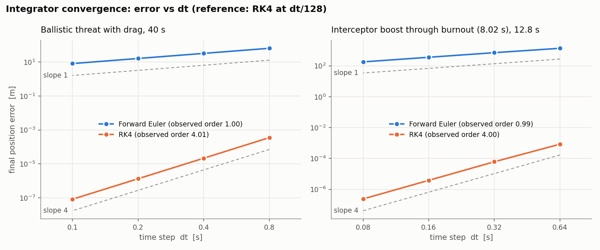

### Analytic checks

With drag off the threat has a closed-form solution $\mathbf r(t) = \mathbf r_0 + \mathbf v_0 t - \tfrac12 g t^2\hat{\mathbf z}$. RK4 is exact for this quadratic and reproduces it to $5.8\times10^{-11}$ m over 40 s, a few times machine epsilon at 60 km. Forward Euler gets the velocity exactly, and its altitude lags by exactly the truncation error $g\,t\,\Delta t/2$, to within $4.5\times10^{-11}$ m.

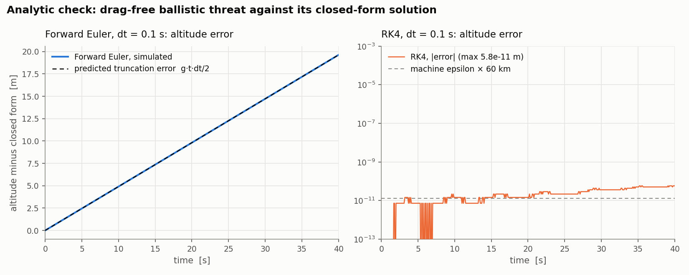

`tests/test_integrators.py` also checks energy conservation without drag, that the energy lost with drag equals the drag work $\int k\lVert\mathbf v\rVert^3dt$, the mass flow $F/(I_{sp} g_0)$, booster separation at burnout, and the rocket-equation $\Delta v = I_{sp} g_0 \ln(m_0/m_b)$.

### Kalman filter consistency

For a consistent filter the normalized estimation error squared and the normalized innovation squared,

$$
\epsilon = (\hat{\mathbf x} - \mathbf x)^\top P^{-1}(\hat{\mathbf x} - \mathbf x),\qquad \epsilon_\nu = \boldsymbol\nu^\top S^{-1}\boldsymbol\nu,
$$

are $\chi^2$ with 6 degrees of freedom. Averaged over $N$ = 50 independent runs, $N$ times the average is $\chi^2_{300}$, giving 95 % bounds [5.08, 7.00]. `scripts/filter_consistency.py`:

| Setting | Mean NEES | Steps inside bounds | Mean NIS | Steps inside bounds |
| --- | --- | --- | --- | --- |
| Matched model: drag off, truth driven by the filter's $Q$ | 6.11 | 94.3 % | 5.99 | 95.1 % |
| As configured: threat with drag | 5.35 | 58.9 % | 5.92 | 94.6 % |

With its own model the filter is consistent. Against the dragged threat, NEES is about 8–9 in the first 15 s (overconfident while drag is strongest) and settles near 5 later (mildly conservative). NIS hardly notices, because with $H = I$ the innovations are dominated by $R$.

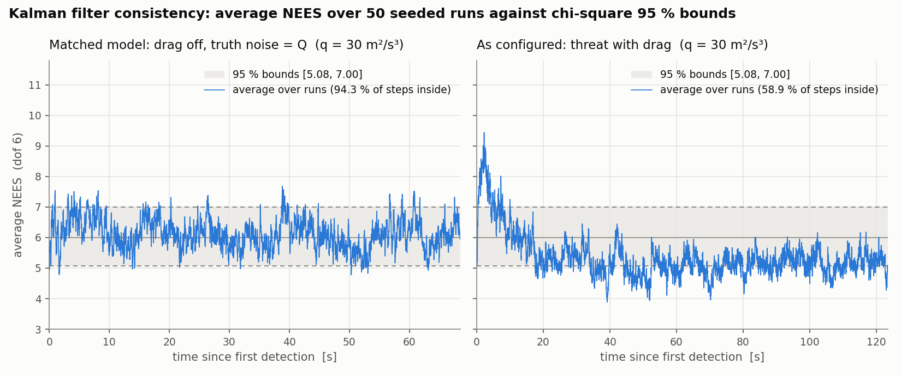

### Consistency of the 7-state EKF

`scripts/ekf7_consistency.py` repeats the check for the EKF7 over $N$ = 200 seeded tracking runs, with each radar model and each atmosphere. The state now includes $k_T$, so the NEES has 7 degrees of freedom (95 % bounds on the average [6.49, 7.53]) and the NIS still has 6 ([5.53, 6.49]). Two settings:

- **Matched model.** The true drag is drawn for each run from the filter's prior and then follows the filter's random walk (`kalman.q_drag`), and the truth is driven by the filter's own white-noise acceleration $Q$. The prior is narrowed to $(3.5 \pm 1.0) \times 10^{-5}\ \mathrm{m^{-1}}$ for this setting only, because the filter clips $\hat k_T$ at zero and the configured $\pm 2.5 \times 10^{-5}$ prior would put 8 % of the true values below it.
- **As configured.** The nominal threat ($k_T = 4 \times 10^{-5}$, no process noise) and the filter exactly as the ablation runs it.

Statistics are over the track up to the median intercept time (58.5 s with constant density, 50.7 s in the exponential atmosphere), which is the part the engagement uses. The values over the whole track to the ground differ by less than 0.1.

| Setting, atmosphere (RAE radar) | Mean 7-state NEES | Steps inside | Mean NIS | Steps inside |
| --- | --- | --- | --- | --- |
| Matched, constant density | 7.08 | 94.0 % | 6.00 | 95.3 % |
| Matched, exponential | 6.87 | 92.8 % | 5.99 | 95.2 % |
| As configured, constant density | 4.55 | 0 % | 5.90 | 94.1 % |
| As configured, exponential | 4.57 | 0 % | 5.90 | 94.2 % |

The Cartesian radar gives the same picture (matched 7.03 and 6.85, as configured 4.43 and 4.44).

| Drag estimate, as configured (RAE; units $10^{-5}\ \mathrm{m^{-1}}$, truth 4.0) | Median $\hat k_T$ | Filter's 1σ | Median absolute error | Normalized error, mean ± s.d. |
| --- | --- | --- | --- | --- |
| Constant density, launch decision (5 s) | 3.99 | 0.29 | 0.04 | −0.03 ± 0.23 |
| Constant density, median intercept | 4.00 | 0.32 | 0.02 | +0.01 ± 0.10 |
| Exponential, launch decision (5 s) | 3.50 | 2.51 | 0.50 | −0.20 ± 0.00 |
| Exponential, median intercept | 3.51 | 2.58 | 0.49 | −0.18 ± 0.07 |

**Reading.**

- **The implementation is consistent with its own model.** In the matched setting the 7-state NEES and the NIS sit inside their bounds, and the normalized drag error has mean 0.04 and standard deviation 0.97 at intercept (constant density), with the truth inside the 95 % interval in 97 % of runs. The exponential case is slightly conservative (mean 6.87, drag s.d. 0.90).
- **As tuned, the filter is conservative, not overconfident.** The average NEES is about 4.5 against an expected 7, and never inside the bounds. The filter assumes $q = 5\ \mathrm{m^2/s^3}$ of random acceleration and a drag random walk, and the nominal threat has neither, so the covariance is larger than the actual error. The NIS does not show this, because the innovations are dominated by $R$. The claimed drag 1σ is 3–10 times the actual scatter. The filter was not retuned, because the ablation results above were produced with these settings.
- **With constant density the drag is learned before the launch decision.** After 5 s the median estimate is within 0.3 % of the truth, the median absolute error is 1.1 %, and the filter's 1σ is 7 % of it. The drag PIP and the feed-forward therefore work with an essentially correct coefficient throughout, which is why they perform as well as they do in that model.
- **In the exponential atmosphere the drag is not learned before intercept.** The estimate is still the prior mean at the median intercept time (3.51 against a prior of 3.5), and the 1σ has not shrunk (2.58 against 2.5). The filter reports this correctly: its error is 0.2σ. The drag-aware components are then running on the prior, not on a measurement, which is the mechanism behind their small contribution in that atmosphere.

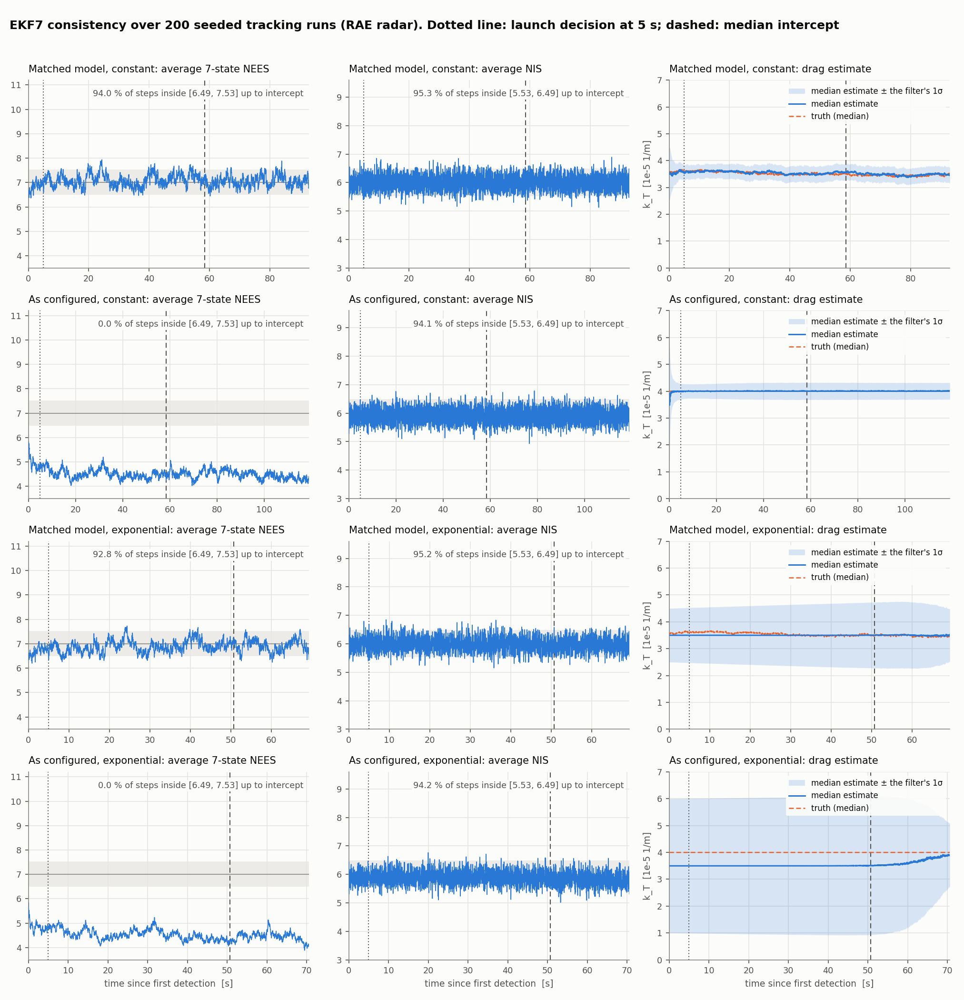

### Drag mismatch in the impact prediction

The baseline 6-state filter and vacuum PIP ignore drag, while the threat has it. Over 100 seeded threats (`scripts/drag_mismatch.py`) the vacuum PIP lies downrange of the true impact point by a median 1.7 km at 80 s to go, 185 m at 40 s and 3 m at 10 s, and the predicted time to impact is too short. In a drag-free control the median along-track error is within ±10 m. At the first launch opportunity, 12 of 100 PIP-gated decisions would launch at a threat that lands outside the defended area, and 1 would hold fire on one that lands inside.

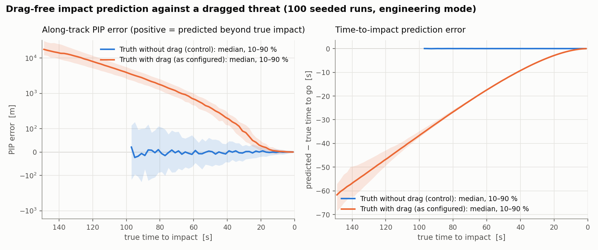

### Closing the model-mismatch loop: 7-state EKF + Drag PIP + Augmented PN

`scripts/gnc_trade_study.py` and `scripts/envelope_study.py` compare the baseline GNC stack (`configs/engineering.yaml`) against the upgraded GNC stack (`configs/advanced.yaml`: 7-state EKF estimating $k_T$, RK4 drag-integrated PIP, polar RAE radar, and Augmented PN in the free-falling relative frame) on the exact same physical interceptor (150 kN boost for 5 s, 30 g limit, 435 m/s divert budget, 10 m kill radius):

- **PIP accuracy**: Integrating the ground crossing with the EKF's estimated drag $\hat k_T$ eliminates the 1.7 km early downrange bias of the vacuum predictor.
- **Divert $\Delta v$ efficiency & battlespace expansion**: By compensating for estimated target drag deceleration in midcourse and eliminating the continuous $+1\,g$ coast bias (since gravity cancels identically between free-falling bodies), Augmented PN slashes kill-vehicle divert $\Delta v$ consumption by more than half and expands the lethal battlespace across high-range, high-altitude threats (rescuing divert-limited misses such as Seed 13 from a 16.7 m miss to a 1.96 m hit using only 136.8 m/s of divert $\Delta v$).

The upgrade changes four things at once, so the ablation below attributes the gain to each one.

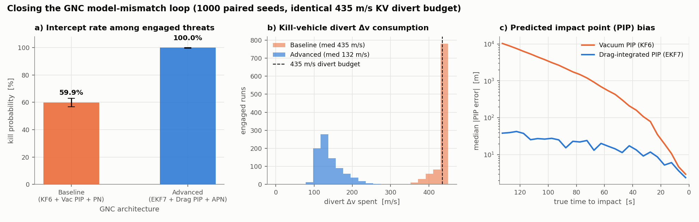

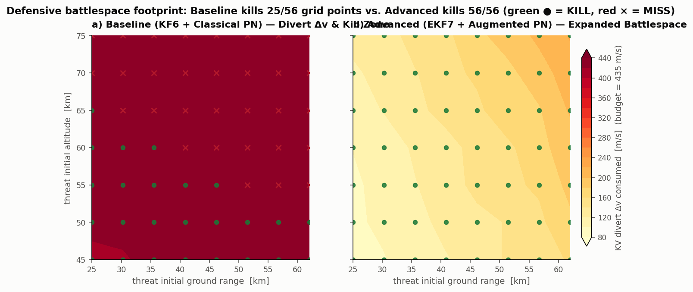

### Component ablation (1000 paired seeds)

`scripts/ablation_study.py` runs nine configurations on seeds 0–999 with the identical interceptor and threats, so each seed is a matched pair across configurations. A test (`tests/test_ablation.py`) checks that its fast engagement loop reproduces `thaad_sim.batch.run_metrics`.

This subsection and the sensitivity sweeps after it use the presets' constant-density drag. The rerun in an exponential atmosphere ([below](#the-same-studies-in-an-exponential-atmosphere)) keeps the coast-gravity finding but removes every drag-related effect, so read the drag conclusions here as properties of the constant-density model.

**Metrics.** A scenario is *threatening* when the unintercepted threat would land inside the 30 km defended radius (845 of 1000). The **protection rate** is the share of threatening scenarios that end in a kill; its denominator is the same for every configuration. The kill rate among engaged threats is not comparable across configurations, because each one makes its own PIP-gated launch decisions (the baseline engages 960 threats, the drag-PIP configurations about 850). A **false engagement** is a launch at a threat that would have landed outside the defended area (of 155). Differences in protection are tested with the exact two-sided McNemar test on the discordant pairs ($b$ = seeds only the reference kills, $c$ = seeds only the comparison kills). Differences in divert use are the median per-seed paired difference over seeds both configurations engaged, with a 4000-resample percentile bootstrap 95 % interval.

| Configuration (filter + PIP + guidance, radar) | Protection (95 % CI) | Median divert $\Delta v$ | False engagements |
| --- | --- | --- | --- |
| C1 KF6 + vacuum + PN, Cartesian (baseline) | 56.8 % (53.4–60.1) | 435 m/s | 115 |
| C2 KF6 + vacuum + PN, RAE | 56.3 % (53.0–59.6) | 435 m/s | 115 |
| C3 EKF7 + vacuum + PN | 58.0 % (54.6–61.3) | 435 m/s | 113 |
| C4 EKF7 + drag + PN | 57.8 % (54.4–61.0) | 435 m/s | 5 |
| C5 KF6 + vacuum + APN ($\hat{\mathbf a}_T = 0$: PN without coast gravity term) | 100 % (99.5–100) | 271 m/s | 115 |
| C6 EKF7 + vacuum + APN | 100 % (99.5–100) | 132 m/s | 113 |
| C7 EKF7 + drag + APN | 100 % (99.5–100) | 132 m/s | 5 |
| C8 EKF7 + drag + ZEM | 100 % (99.5–100) | 130 m/s | 5 |
| C9 EKF7 + drag + APN, RAE (`advanced.yaml`) | 100 % (99.5–100) | 132 m/s | 3 |

| One-factor change | Protection change ($b$ / $c$, McNemar $p$) | Paired divert change, median [95 % CI] | False engagements |
| --- | --- | --- | --- |
| Cartesian → RAE radar (C1 → C2) | −0.5 pt (14 / 10, $p$ = 0.54) | 0 m/s | 115 → 115 |
| KF6 → EKF7 (C1 → C3) | +1.2 pt (1 / 11, $p$ = 0.006) | 0 m/s | 115 → 113 |
| vacuum → drag PIP, PN (C3 → C4) | −0.2 pt (2 / 0, $p$ = 0.50) | 0 m/s | 113 → 5 |
| **PN → PN without coast gravity term (C1 → C5)** | **+43.2 pt (0 / 365, $p < 10^{-100}$)** | **−158 [−163, −154] m/s** | 115 → 115 |
| add EKF7 drag feed-forward (C5 → C6) | 0 (0 / 0) | −137 [−141, −134] m/s | 115 → 113 |
| vacuum → drag PIP, APN (C6 → C7) | 0 (0 / 0) | 0 m/s | 113 → 5 |
| APN → ZEM (C7 → C8) | 0 (0 / 0) | −2.8 [−3.6, −2.1] m/s | 5 → 5 |
| Cartesian → RAE radar, full stack (C7 → C9) | 0 (0 / 0) | +0.4 [−0.0, +0.9] m/s | 5 → 3 |

**Reading.** Every baseline miss is a divert-exhausted miss, and the one-factor change that recovers them is in the guidance law. Classical PN commands $+g\hat{\mathbf z}$ for the whole flight (§4). During the kill vehicle's coast both bodies fall freely, so gravity cancels in the relative motion and the term pushes the kill vehicle off the collision course. PN's LOS-rate term then partly works against it, so the net cost is below $g$ per second: on the 575 seeds where both C1 and C5 kill, C1 spends a median 183 m/s more divert, about 3.6 m/s per second of coast. Dropping the term after burnout (C5) recovers all 365 lost kills without any change to the filter or the PIP. Putting drag into the filter without changing the guidance barely helps (C3 58.0 %, C4 57.8 %), because PN does not use the estimated target acceleration. The drag-aware estimator instead has two separate effects that do not show up as kills at the nominal budget: drag feed-forward halves divert use (margin), and the drag-integrated PIP almost removes launches at threats that will land outside the defended area (interceptor economy). The RAE radar and ZEM change neither beyond noise. Because every C5–C9 configuration protects all 845 threatening threats at 435 m/s, the sweeps below change the divert budget and the threat drag to separate them.

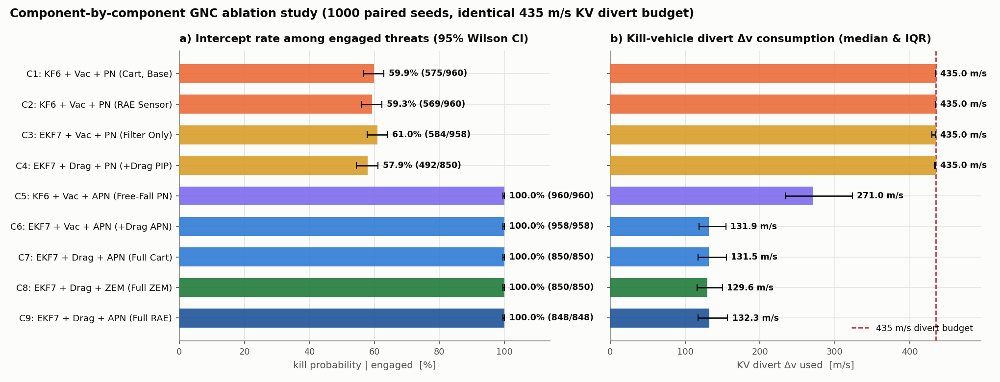

### Sensitivity to divert budget and threat drag (1000 paired seeds per point)

`scripts/sensitivity_study.py` reruns four of the ablation configurations on seeds 0–999: C1 (baseline), C5 (PN without the coast gravity term), C7 (EKF7 + drag PIP + APN) and C9 (`advanced.yaml`). It changes one parameter at a time: the kill-vehicle divert budget at the nominal threat drag, and the true threat drag $k_T$ at the nominal 435 m/s budget. The filters are not retuned, so KF6 still assumes no drag and the EKF7 keeps its prior $\hat k_T = (3.5 \pm 2.5) \times 10^{-5}\ \mathrm{m^{-1}}$. The threatening set is recomputed for each drag value, because drag changes where the unintercepted threat lands. Metrics and tests are as in the ablation.

**Divert budget** (nominal drag, 845 threatening):

| Budget [m/s] | 100 | 150 | 200 | 250 | 300 | 350 | 435 | 550 |
| --- | --- | --- | --- | --- | --- | --- | --- | --- |
| C1 baseline | 0 % | 0 % | 0 % | 0 % | 1.2 % | 13.2 % | 56.8 % | 99.0 % |
| C5 PN without coast $+g$ | 0 % | 9.8 % | 38.8 % | 66.5 % | 85.9 % | 97.4 % | 100 % | 100 % |
| C7 EKF7 + drag PIP + APN | 68.3 % | 93.1 % | 99.6 % | 100 % | 100 % | 100 % | 100 % | 100 % |
| C9 `advanced.yaml` (RAE) | 68.8 % | 93.0 % | 99.6 % | 100 % | 100 % | 100 % | 100 % | 100 % |

The smallest tested budget that protects at least 99 % of threatening threats is 550 m/s for the baseline, 435 m/s without the coast gravity term and 200 m/s with the drag feed-forward. Below the nominal budget the feed-forward's margin turns into kills: at 200 m/s, C5 → C7 rescues 514 seeds and loses none (+60.8 pt, $p < 10^{-100}$), and at 150 m/s it rescues 704 (+83.3 pt). The radar model makes no significant difference at any budget (C7 → C9, largest discordance 4 / 8 at 100 m/s, $p$ = 0.39).

**Threat drag** (435 m/s budget):

| True $k_T$ [$10^{-5}\ \mathrm{m^{-1}}$] | Threatening | Protection C1 / C5 / C7 / C9 | Median divert $\Delta v$ C1 / C5 / C7 | False engagements: vacuum PIP (C1 = C5) / C7 / C9 |
| --- | --- | --- | --- | --- |
| 0 | 827 | 100 / 100 / 100 / 100 % | 390 / 144 / 127 m/s | 7 / 36 / 28 of 173 |
| 1 | 940 | 94.7 / 100 / 100 / 99.8 % | 428 / 195 / 110 m/s | 14 / 4 / 2 of 60 |
| 2 | 925 | 76.1 / 100 / 100 / 99.9 % | 435 / 229 / 110 m/s | 35 / 6 / 5 of 75 |
| **4 (nominal)** | 845 | 56.8 / 100 / 100 / 100 % | 435 / 271 / 132 m/s | 115 / 5 / 3 of 155 |
| 6 | 669 | 50.7 / 100 / 100 / 100 % | 435 / 302 / 164 m/s | 288 / 22 / 15 of 331 |
| 8 | 490 | 47.4 / 100 / 99.6 / 99.2 % | 435 / 326 / 206 m/s | 465 / 15 / 13 of 510 |

**Reading.**

- **The baseline's misses need two things at once.** Against a drag-free threat the baseline protects all 827 threatening threats at a median 390 m/s, and protection falls to 47 % as drag grows. Without the coast gravity term it stays at 100 % over the whole range, even though KF6 and the vacuum PIP know nothing about drag. Unmodelled drag costs divert by itself (C5 rises from 144 to 326 m/s). The gravity term adds a paired median of 244 m/s at $k_T = 0$ and 183 m/s at the nominal drag (seeds where both kill), and that pushes the total over the budget.
- **Feed-forward margin.** C7 spends a paired median of 92–135 m/s less than C5 for every $k_T \ge 2 \times 10^{-5}$, but only 18 m/s against a drag-free threat, where there is nothing to feed forward.
- **Launch economy.** The vacuum PIP's false engagements grow with drag, from 4 % of non-threatening threats at $k_T = 0$ to 91 % at $8 \times 10^{-5}$, because a dragged threat falls short of the vacuum prediction. The drag PIP holds them to 3–8 % at every nonzero drag. Against a drag-free threat it does worse than the vacuum PIP (36 vs. 7 of 173, $p < 10^{-8}$). The launch decision comes after 5 s of tracking. By then the estimate has left its prior and its 1σ is about $0.3 \times 10^{-5}$, but the filter clips $\hat k_T$ at zero, so against a drag-free threat every estimation error is positive (median $0.1 \times 10^{-5}$, largest $1.6 \times 10^{-5}$ of 60 runs at 5 s). What turns this into launches is the one-sided spread, not the small median: over the 834 seeds both configurations launched on, the drag PIP's predicted range at launch is short of the true impact by a median 156 m with a standard deviation of 800 m, against +8 m and 151 m for the vacuum PIP. On its 36 false launches the drag PIP was short by a median 1.1 km (up to 2.8 km), on threats that land a median 760 m (up to 2.7 km) beyond the defended radius; the vacuum PIP's 7 were short by a median 230 m. This is consistent with the clip as the cause, but no run with the clip removed has tested it. The RAE radar removes a few of these launches (28 vs. 36, $p$ = 0.008).

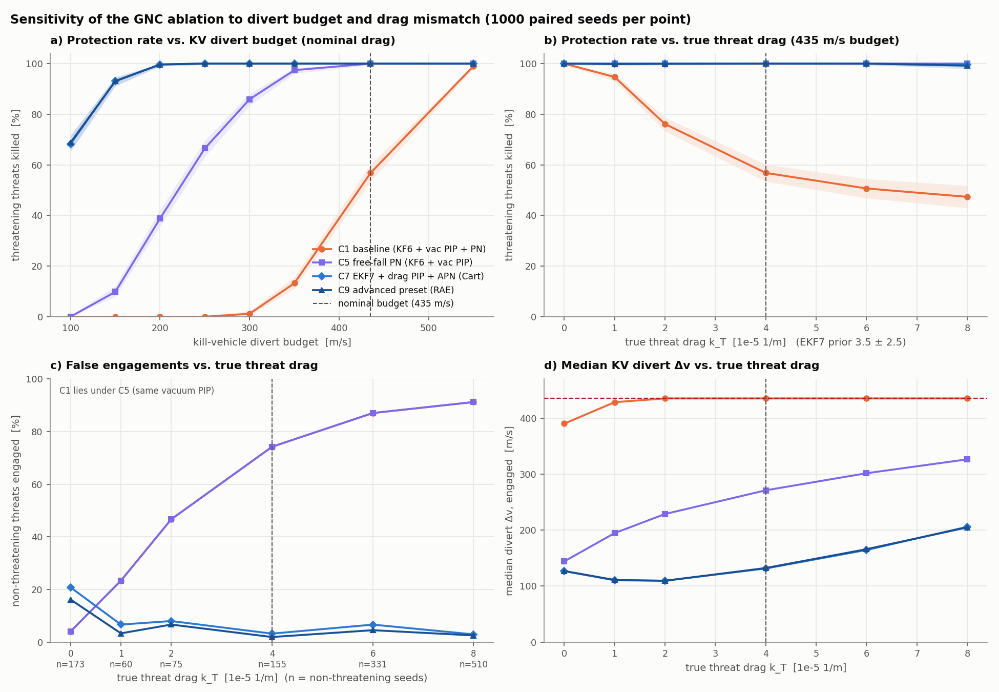

### The same studies in an exponential atmosphere

Both scripts were rerun with `--atmosphere exponential` (§2.1): density falls off as $e^{-z/H}$ with $H = 7$ km, the drag coefficients become sea-level values, and the EKF7, the drag feed-forward and the drag PIP use the same density model. Seeds, interceptor, filter tuning and metrics are unchanged. Of the 1000 scenarios 830 are threatening and 170 are not.

| Configuration | Protection (95 % CI) | Median divert $\Delta v$ | False engagements (of 170) | Constant density, for comparison |
| --- | --- | --- | --- | --- |
| C1 KF6 + vacuum + PN, Cartesian (baseline) | 100 % (99.5–100) | 390 m/s | 4 | 56.8 %, 435 m/s, 115 |
| C2 KF6 + vacuum + PN, RAE | 99.8 % (99.1–99.9) | 389 m/s | 6 | 56.3 %, 435 m/s, 115 |
| C3 EKF7 + vacuum + PN | 99.9 % (99.3–100) | 382 m/s | 1 | 58.0 %, 435 m/s, 113 |
| C4 EKF7 + drag + PN | 100 % (99.5–100) | 382 m/s | 2 | 57.8 %, 435 m/s, 5 |
| C5 KF6 + vacuum + APN (PN without coast gravity term) | 100 % (99.5–100) | 146 m/s | 4 | 100 %, 271 m/s, 115 |
| C6 EKF7 + vacuum + APN | 99.9 % (99.3–100) | 130 m/s | 1 | 100 %, 132 m/s, 113 |
| C7 EKF7 + drag + APN | 100 % (99.5–100) | 130 m/s | 2 | 100 %, 132 m/s, 5 |
| C8 EKF7 + drag + ZEM | 100 % (99.5–100) | 131 m/s | 2 | 100 %, 130 m/s, 5 |
| C9 EKF7 + drag + APN, RAE (`advanced.yaml`) | 100 % (99.5–100) | 130 m/s | 3 | 100 %, 132 m/s, 3 |

No one-factor change moves protection or false engagements significantly (every McNemar $p \ge 0.25$). Two changes move divert use: dropping the coast gravity term (C1 → C5) saves a paired median of 243 m/s [95 % CI 240, 245], and KF6 → EKF7 saves 15 m/s with APN (C5 → C6, [15.1, 15.4]) and 8 m/s with PN (C1 → C3). The drag PIP, ZEM and the RAE radar change divert by less than 1 m/s.

Four of the 9000 runs miss. Seeds 40 and 683 on C2 exhaust the divert budget and pass at about 10 m. Seed 483 on C3 and C6 (EKF7 with the vacuum PIP) has a predicted impact on the 30 km defended-area boundary, launches at 65 s instead of in the first 12 s, and misses by 20 km.

**Divert budget** (nominal sea-level drag, 830 threatening):

| Budget [m/s] | 100 | 150 | 200 | 250 | 300 | 350 | 435 | 550 |
| --- | --- | --- | --- | --- | --- | --- | --- | --- |
| C1 baseline | 0 % | 0 % | 0 % | 0 % | 21.4 % | 68.3 % | 100 % | 100 % |
| C5 PN without coast $+g$ | 88.8 % | 100 % | 100 % | 100 % | 100 % | 100 % | 100 % | 100 % |
| C7 EKF7 + drag PIP + APN | 92.5 % | 100 % | 100 % | 100 % | 100 % | 100 % | 100 % | 100 % |
| C9 `advanced.yaml` (RAE) | 92.2 % | 100 % | 100 % | 100 % | 100 % | 100 % | 100 % | 100 % |

**Threat drag** (sea-level $k_T$ from 0 to $8 \times 10^{-5}\ \mathrm{m^{-1}}$, 435 m/s budget): protection is 99.9–100 % for all four configurations at every value, median divert stays within 1 m/s of 390 (C1), 145 (C5) and 130 m/s (C7, C9), the threatening set only moves between 827 and 831, and false engagements stay between 1 and 7 of about 170.

**Reading.**

- **The drag effects were produced by the constant-density model.** Kills happen at a median 34.5 km altitude (range 25–43 km), where density is under 1 % of its sea-level value. Up to the intercept the threat is close to drag-free, so the vacuum PIP is nearly right, there is almost nothing to feed forward, and the baseline's 43-point protection deficit and its 115 false launches both disappear. Each exponential row is close to the constant-density drag-free row of the table above (390 / 144 / 127 m/s).
- **The coast gravity term remains.** It is the only component with a large effect: 243 m/s of divert. The baseline needs the full 435 m/s budget for complete protection and is at 68 % with 350 m/s, while PN without the term protects every threatening threat with 150 m/s.
- **Drag estimation contributes little before intercept.** The EKF7's drag estimate is still near its $3.5 \times 10^{-5}$ prior when the engagement ends, because drag is not observable in thin air (`tests/test_atmosphere.py` shows it converging only below about 30 km). Its 15 m/s saving has not been separated into drag feed-forward and the lower velocity error (median RMS 2.0 vs. 3.1 m/s). The saving does decide kills at a tight budget. At 100 m/s C7 protects 92.5 % (90.5–94.1) against 88.8 % (86.5–90.8) for C5. The intervals overlap, but the paired test separates them: C5 → C7 rescues 34 seeds and loses 3 (McNemar $p = 1.2 \times 10^{-7}$). This is the only effect of the drag-aware stack on kills in this atmosphere.
- **Which model to trust.** The exponential atmosphere is the more realistic of the two for an intercept above 25 km. The constant-density results above stand as a description of that model, and as a caution: an altitude-independent drag coefficient changes the conclusion of the trade study, not just its numbers.

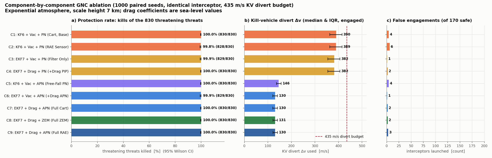

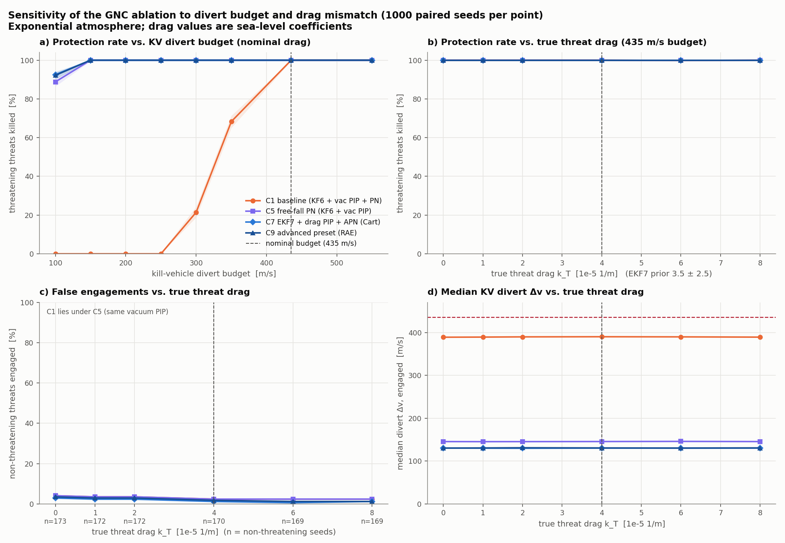

### Batch statistics

`python -m thaad_sim.batch` runs N seeded engagements; rates are reported with 95 % Wilson score intervals. Over seeds 0–999, engineering mode engages 960 threats and kills 575 of them: 59.9 % (95 % CI 56.8–63.0 %). All 385 misses had spent the full divert budget. The demo kills 1000 of 1000 (95 % CI 99.6–100 %). `python -m thaad_sim.dashboard results/engineering.csv` collects these results with the studies above in one page. The workstation's live Monte Carlo (§9) calls the same per-run metrics through the same process pool, so a live batch over seeds 0 to N−1 matches the first N rows of the CSV for the same settings.

### Colour and contrast

`scripts/palette_check.py` checks the replay and dashboard colours: every pair of scene identity colours (threat, interceptor, accent, Kalman track, radar returns, uncertainty ellipsoid) for separation under simulated protanopia and deuteranopia (Machado et al. 2009, OKLab ΔE ≥ 8 target) and under normal vision (ΔE ≥ 15), every mark against the rendered sky, terrain, defended area, cloud deck and HUD in both rendering styles (WCAG ≥ 3:1), and text tokens (≥ 4.5:1). The audit changed the Kalman track to mint, the radar returns to a neutral slate, the ellipsoid to violet, brightened the faint HUD text and dimmed the cinematic cloud deck. Every check now passes, and `tests/test_presentation.py` keeps it that way.

## 8. Limitations

- **Flat Earth, constant gravity**, no rotation. Acceptable for engagements of tens of kilometres, not for longer flights.
- **Drag** has a constant coefficient by default, with no atmosphere or Mach dependence, so it acts at full strength at 70 km and overstates the slowing of a real high-altitude threat (a dragged threat takes 1.5–2× its nominal flight time). `sim.atmosphere: exponential` (§2.1) adds an isothermal density profile, and the ablation's drag-related conclusions do not hold under it (§7). There is still no Mach-dependent drag coefficient, and the presets, the workstation and the browser replay engine use constant density.
- **Baseline filter & predictor mismatch vs. Advanced EKF**: The baseline preset (`configs/engineering.yaml`) intentionally uses a 6-state drag-free filter and vacuum predictor so the resulting PIP bias and early overconfidence can be measured (`scripts/drag_mismatch.py`, `scripts/filter_consistency.py`). `configs/advanced.yaml` resolves both with a 7-state Extended Kalman Filter (`kalman.filter_type: ekf7`) that estimates $k_T$ online and an RK4 drag-integrated impact predictor (`kalman.pip_mode: drag`).
- **Radar measurement model**: The baseline preset uses an idealized Cartesian position-and-velocity sensor (`sensor.model: cartesian`), whereas `configs/advanced.yaml` uses a polar Range–Azimuth–Elevation (RAE) + Doppler radar (`sensor.model: rae`) with beam-aligned $6\times 6$ covariance; neither models update-rate scheduling, clutter, dropouts, or false tracks.
- **Point masses**: no 6-DOF attitude dynamics, seeker field-of-view limits, or warhead/lethality fragmentation model. An optional 1st-order actuator lag (`interceptor.tau`) is supported, and a kill is geometric (closest approach under 10 m).
- **Propulsion** has constant thrust and specific impulse. The divert budget is a Δv limit, not propellant mass.
- **Guidance timing**: the command is held over each step, so the closed loop converges at first order in Δt whatever the integrator. The vehicle dynamics between commands are integrated at the integrator's order.
- **Visualization**: in the replay, vehicle models are drawn about 8× real size and the uncertainty ellipsoid 10×; the workstation's vehicle scale is adjustable (12× by default). In the Analysis Guidance tab, both the true and the filter-perceived LOS rate and zero-effort miss are plotted together so the effect of estimation noise and unmodeled drag on the guidance law can be inspected directly.

## 9. Live workstation

`python -m thaad_sim --serve` (`thaad_sim/server.py`) wraps the simulation in a small FastAPI app. Each request applies the form's settings as overrides on a config file (filter type, PIP mode, sensor model, guidance law, navigation gain, divert budget, actuator lag, g limit), calls the same `simulate()` as the CLI, and returns the history packed by `thaad_sim/telemetry.py`. Picking a different filter does not otherwise change the config, except that switching a config tuned for `kf6` ($q \ge 25$) to `ekf7` lowers the process noise to $q = 5\ \mathrm{m^2/s^3}$ unless it is set explicitly.

`telemetry.py` derives the per-frame series that the Engagement readouts and the Analysis plots show. With $\mathbf r = \mathbf r_T - \mathbf r_I$ and $\mathbf v = \mathbf v_T - \mathbf v_I$ from the truth, and the same quantities from the filter estimate for the "est" series:

$$
V_c = -\frac{\mathbf r\cdot\mathbf v}{\lVert\mathbf r\rVert},\qquad
t_{go} = \frac{\lVert\mathbf r\rVert}{V_c},\qquad
\lVert\boldsymbol\omega\rVert = \frac{\lVert\mathbf r\times\mathbf v\rVert}{\lVert\mathbf r\rVert^2},\qquad
\mathbf{ZEM} = \mathbf r + \mathbf v\,\max\!\left(0, -\frac{\mathbf r\cdot\mathbf v}{\lVert\mathbf v\rVert^2}\right).
$$

These readouts use the drag-free ZEM; the ZEM guidance law adds the estimated target drag term (§4). The divert Δv shown is the integral of the achieved lateral acceleration over the kill vehicle's coast, and the impact-prediction error is the horizontal distance from the instantaneous PIP (vacuum, or drag-integrated every 10 frames in `drag` mode) to the true impact point, found by integrating the true threat state to the ground. Terminal homing is marked when the kill vehicle is coasting within 15 km of the threat; the model has no seeker, so this is a display phase only.

The line-of-sight rate diverges as $\lVert\mathbf r\rVert \to 0$ at closest approach, so its plot scales the axis to 1.6× the 97th percentile of the run rather than to the final spike; values above the axis are drawn at the top edge. All other plots use the full data range.

Comparing guidance laws runs three requests on one seed: KF6 with vacuum PIP and PN on `engineering.yaml`, and EKF7 with drag PIP, polar radar and APN or ZEM on `advanced.yaml`, all with the form's divert budget, navigation gain and g limit and no actuator lag. The threat is identical across the three because the scenario depends only on the seed.

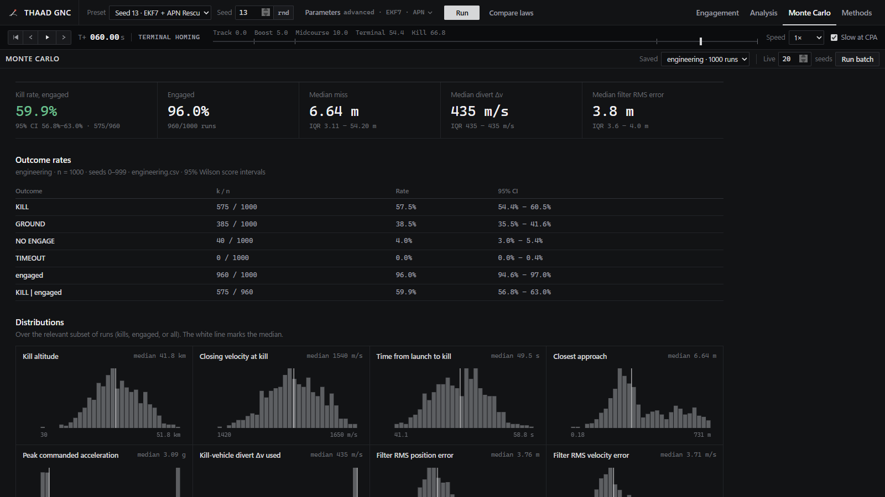
