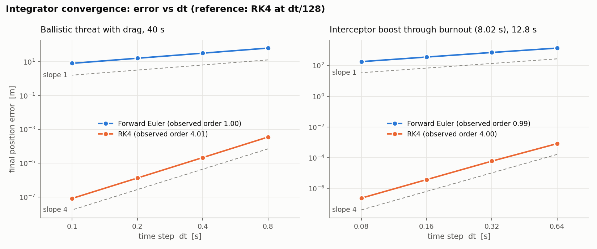
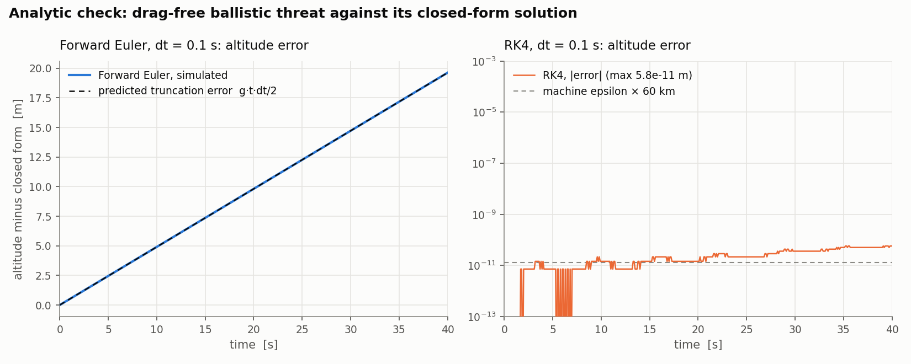
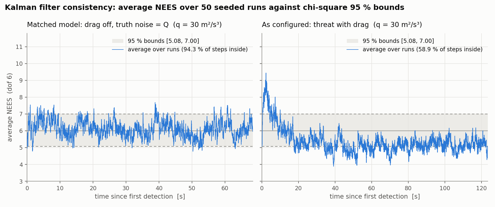
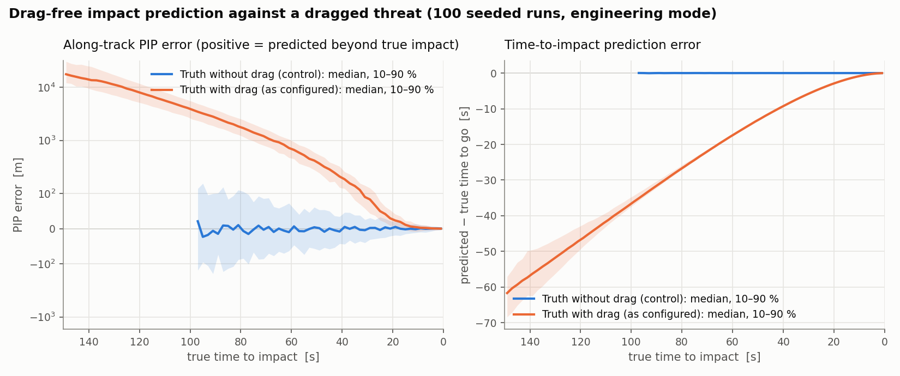
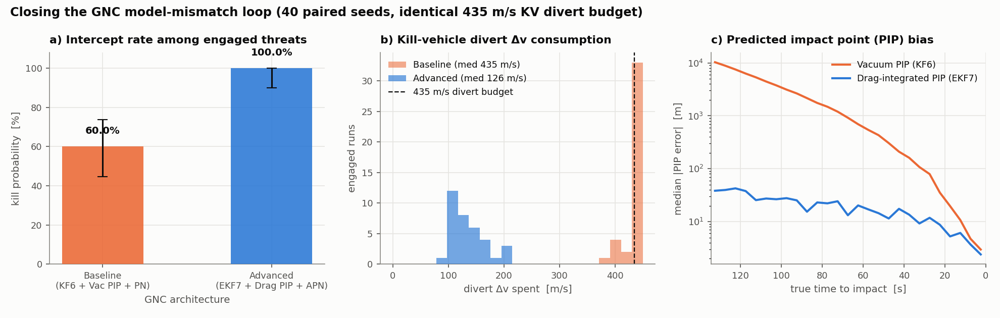
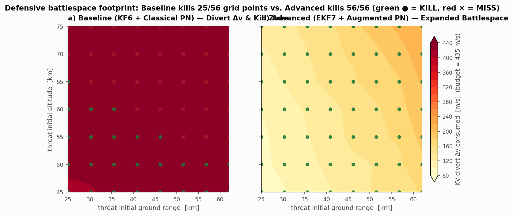

# Methods

A short technical description of what the simulation computes, how it was verified, and where it stops being a good model. Parameter values are those of `configs/engineering.yaml` unless noted; `configs/demo.yaml` uses the same equations with different numbers.

> Educational simulation. The parameters are chosen to make the dynamics visible and are not data for any real system.

## 1. Frame, state and integration

The frame is flat-Earth east–north–up: $x$ east, $y$ north, $z$ up, in SI units, with the defended point at the origin and constant gravity $g = 9.81\ \mathrm{m/s^2}$.

Each body is a point mass whose state is advanced as one first-order system $\dot{\mathbf x} = f(\mathbf x)$:

| Body | State |
| --- | --- |
| Threat | $[\mathbf r, \mathbf v]$, 6 values |
| Interceptor | $[\mathbf r, \mathbf v, m]$, 7 values, so mass is integrated with the motion |

`sim.integrator` selects classical fourth-order Runge–Kutta (default) or forward Euler, at $\Delta t = 0.02$ s:

$$
\mathbf k_1 = f(\mathbf x_n),\quad
\mathbf k_2 = f\!\left(\mathbf x_n + \tfrac{\Delta t}{2}\mathbf k_1\right),\quad
\mathbf k_3 = f\!\left(\mathbf x_n + \tfrac{\Delta t}{2}\mathbf k_2\right),\quad
\mathbf k_4 = f(\mathbf x_n + \Delta t\,\mathbf k_3),
$$

$$
\mathbf x_{n+1} = \mathbf x_n + \tfrac{\Delta t}{6}\left(\mathbf k_1 + 2\mathbf k_2 + 2\mathbf k_3 + \mathbf k_4\right).
$$

Inputs that are not part of the state (the guidance command) are held constant over a step. Burnout is a discontinuity, so the step that contains it is split at the burnout time.

## 2. Threat

A point mass under gravity and quadratic drag with a constant coefficient $k_T = 4\times10^{-5}\ \mathrm{m^{-1}}$:

$$
\ddot{\mathbf r}_T = -g\,\hat{\mathbf z} - k_T\,\lVert\dot{\mathbf r}_T\rVert\,\dot{\mathbf r}_T .
$$

Each scenario draws a nominal time to impact $T$ (70–100 s), an initial altitude $z_0$ (55–75 km), a ground range (35–55 km) at a random azimuth, and an aim point up to 35 km from the origin. The initial velocity is the vacuum ballistic solution that reaches the aim point after $T$,

$$
v_{z0} = \frac{\tfrac12 g T^2 - z_0}{T},\qquad v_{x0} = \frac{x_{aim} - x_0}{T},\qquad v_{y0} = \frac{y_{aim} - y_0}{T},
$$

multiplied by a drag compensation factor of 1.03.

## 3. Interceptor

Two stages. During boost a constant thrust $F_T$ = 150 kN acts along the guidance command; propellant burns at the rate set by thrust and specific impulse until $m_0 - m_b$ is spent:

$$
m\,\ddot{\mathbf r}_I = F_T\,\hat{\mathbf a}_c - m g\,\hat{\mathbf z} - k\,\lVert\dot{\mathbf r}_I\rVert\,\dot{\mathbf r}_I + \eta\, m\,\mathbf a_c,
\qquad \eta = \begin{cases}0.1 & t < t_b\\ 1 & t \ge t_b\end{cases}
$$

$$
\dot m = -\frac{F_T}{I_{sp}\,g_0},\qquad t_b = \frac{(m_0 - m_b)\,I_{sp}\,g_0}{F_T} = 5.0\ \mathrm{s},\qquad g_0 = 9.80665\ \mathrm{m/s^2}.
$$

At burnout the booster separates: the mass state jumps to the kill vehicle's $m_{KV}$ = 200 kg, thrust stops, and the drag coefficient changes from the booster's to the kill vehicle's. The kill vehicle steers with divert thrusters whose total use is capped by a $\Delta v$ budget (435 m/s; unlimited in the demo). Divert propellant is not modeled, so $m_{KV}$ stays constant.

## 4. Guidance and control

Three selectable guidance laws (`interceptor.guidance_law`: `pn`, `apn`, or `zem`) operate on the relative state from the tracking filter ($\mathbf r = \hat{\mathbf r}_T - \mathbf r_I$, $\mathbf v = \hat{\mathbf v}_T - \mathbf v_I$), with navigation constant $N = 4$:

1. **Classical Proportional Navigation (`pn`)**:
   $$
   \boldsymbol\omega = \frac{\mathbf r\times\mathbf v}{\lVert\mathbf r\rVert^2},\qquad
   \mathbf a_c = N\,(\mathbf v\times\boldsymbol\omega) + g\,\hat{\mathbf z}
   $$
2. **Augmented Proportional Navigation (`apn`)**: feeds the 7-state EKF's estimated target aerodynamic drag deceleration $\hat{\mathbf a}_T = -\hat k_T\lVert\hat{\mathbf v}_T\rVert\hat{\mathbf v}_T$ (projected perpendicular to the line of sight $\hat{\mathbf r}$) into the guidance command, and applies $+g\hat{\mathbf z}$ only during boost since gravity cancels identically in the free-falling relative frame ($\ddot{\mathbf r}_{rel} = \mathbf a_{T,drag} - \mathbf a_{I,drag} - \mathbf a_{divert}$):
   $$
   \hat{\mathbf a}_{T,\perp} = \hat{\mathbf a}_T - (\hat{\mathbf a}_T\cdot\hat{\mathbf r})\hat{\mathbf r},\qquad
   \mathbf a_c = N\,(\mathbf v\times\boldsymbol\omega) + \tfrac{N}{2}\hat{\mathbf a}_{T,\perp} + \mathbb I_{\text{boost}}\,g\,\hat{\mathbf z}
   $$
3. **Optimal Zero-Effort Miss (`zem`)**:
   $$
   t_{go} = -\frac{\mathbf r\cdot\mathbf v}{\lVert\mathbf v\rVert^2},\qquad
   \mathbf{ZEM} = \mathbf r + \mathbf v\,t_{go} + \tfrac12\hat{\mathbf a}_T\,t_{go}^2,\qquad
   \mathbf a_c = \frac{N}{t_{go}^2}\mathbf{ZEM}_\perp + \mathbb I_{\text{boost}}\,g\,\hat{\mathbf z}
   $$

All laws enforce the lateral acceleration cap and kill-vehicle divert budget, with optional first-order autopilot / DACS actuator lag $\tau$ (`interceptor.tau`):

$$
\tau\dot{\mathbf a}_{act} + \mathbf a_{act} = \mathbf a_c,\qquad
\lVert\mathbf a_{act}\rVert \le n_{max}\,g = 30\,g,\qquad
\int_{t_b}^{t}\lVert\mathbf a_{act}\rVert\,d\tau \le \Delta v_{KV}.
$$

The command is computed once per step and held over it. Below 20 m range no command is issued.

## 5. Sensing and tracking

### 5.1 Cartesian vs. Range–Azimuth–Elevation (RAE) radar (`sensor.model`)
In baseline mode (`cartesian`), the radar measures Cartesian position and velocity with independent Gaussian noise, $\sigma_p = 25$ m and $\sigma_v = 8$ m/s per axis. In polar radar mode (`rae`, used in `configs/advanced.yaml`), the radar at the origin measures range $r$, azimuth $\theta$, elevation $\phi$, and Doppler range-rate $\dot r$ with $\sigma_r = 10$ m, $\sigma_\theta = \sigma_\phi = 1.2$ mrad, and $\sigma_{\dot r} = 3$ m/s. Converting to East–North–Up along the orthonormal radar beam triad $(\mathbf u_r, \mathbf u_\theta, \mathbf u_\phi)$ yields the anisotropic $3\times 3$ position covariance:

$$
R_p = \sigma_r^2\,\mathbf u_r\mathbf u_r^\top + (r\cos\phi\,\sigma_\theta)^2\,\mathbf u_\theta\mathbf u_\theta^\top + (r\sigma_\phi)^2\,\mathbf u_\phi\mathbf u_\phi^\top .
$$

### 5.2 6-state linear KF (`kf6`) vs. 7-state Extended Kalman Filter (`ekf7`)
In baseline mode (`kf6`), a six-state linear Kalman filter tracks $[\mathbf r, \mathbf v]$ with gravity as a known control input and continuous white-noise acceleration of spectral density $q = 30\ \mathrm{m^2/s^3}$ per axis:

$$
\mathbf x_{k+1} = F\mathbf x_k + B\mathbf u + \mathbf w_k,\qquad \mathbf z_k = H\mathbf x_k + \boldsymbol\nu_k,
$$

$$
F = \begin{bmatrix} I & \Delta t\, I\\ 0 & I\end{bmatrix},\quad
B = \begin{bmatrix} \tfrac12\Delta t^2 I\\ \Delta t\, I\end{bmatrix},\quad
\mathbf u = -g\,\hat{\mathbf z},\quad
H = I,\quad
R = \operatorname{diag}(\sigma_p^2 I,\ \sigma_v^2 I),\quad
Q = q\begin{bmatrix} \tfrac13\Delta t^3 I & \tfrac12\Delta t^2 I\\ \tfrac12\Delta t^2 I & \Delta t\, I\end{bmatrix}.
$$

In `configs/advanced.yaml` (`kalman.filter_type: ekf7`), the state vector is augmented with the threat's ballistic drag coefficient $k_T$:

$$
\mathbf x_7 = \begin{bmatrix}\mathbf r\\ \mathbf v\\ k_T\end{bmatrix}\in\mathbb R^7,\qquad
\dot{\mathbf r} = \mathbf v,\qquad
\dot{\mathbf v} = -g\hat{\mathbf z} - k_T\lVert\mathbf v\rVert\mathbf v,\qquad
\dot k_T = 0.
$$

The state is propagated over $\Delta t$ with RK4, and the $7\times 7$ covariance $P_7$ is propagated with $\Phi = I_7 + F(\hat{\mathbf x}_7)\Delta t + \tfrac12(F(\hat{\mathbf x}_7)\Delta t)^2$ using the exact analytical Jacobian:

$$
\frac{\partial\dot{\mathbf v}}{\partial\mathbf v} = -k_T\left(\lVert\mathbf v\rVert I_3 + \frac{\mathbf v\mathbf v^\top}{\lVert\mathbf v\rVert}\right),\qquad
\frac{\partial\dot{\mathbf v}}{\partial k_T} = -\lVert\mathbf v\rVert\mathbf v.
$$

Both filters use a linear solve for the Kalman gain and the numerically stable Joseph form for the covariance update:

$$
S = HP^-H^\top + R,\qquad K = P^-H^\top S^{-1},\qquad \mathbf x = \mathbf x^- + K(\mathbf z - H\mathbf x^-),\qquad P = (I - KH)P^-(I - KH)^\top + KRK^\top .
$$

The first measurement initializes the state with $P_0 = R$.

**The track-uncertainty layer in the replay.** The viewer draws the filter's $3\sigma$ position ellipsoid: the position block of $P$ is diagonalized every frame, and the semi-axes are $3\sqrt{\lambda_i}$ along the eigenvectors. The geometry is exaggerated 10× about the true threat position (both the ellipsoid and the estimate's offset from the truth), so the threat is inside the shell exactly when the estimate error is inside the $3\sigma$ ellipsoid. With the Cartesian sensor model (`engineering.yaml`) the ellipsoid is a sphere; with the polar RAE sensor model (`advanced.yaml`), it renders as a true oriented pancake ellipsoid aligned with the radar line of sight.

## 6. Launch decision and kill assessment

**Predicted impact point (PIP).** In `vacuum` mode (`engineering.yaml`), the PIP is the closed-form drag-free ground crossing from the current estimate:

$$
t^\ast = \frac{v_z + \sqrt{v_z^2 + 2 g z}}{g},\qquad \mathrm{PIP} = (x + v_x t^\ast,\ y + v_y t^\ast).
$$

In `drag` mode (`advanced.yaml`), `predict_impact_drag` integrates $[\hat{\mathbf r}, \hat{\mathbf v}]$ forward to $z = 0$ with RK4 under the EKF's live estimated drag $\hat k_T$, eliminating the downrange vacuum overshoot.

In engineering mode the interceptor launches once the track is 5 s old, the estimate is descending and $\lVert\mathrm{PIP}\rVert \le R_D$ = 30 km; otherwise the outcome is `NO ENGAGE`. The demo launches on the first descending estimate after 3 s.

**Kill check.** Within each step, both bodies move along the straight chords between their integrated start and end positions, and the closest point of approach decides the kill:

$$
t_{min} = \operatorname{clamp}\!\left(-\frac{\Delta\mathbf p\cdot\Delta\mathbf v}{\lVert\Delta\mathbf v\rVert^2},\ 0,\ \Delta t\right),\qquad \text{kill if } \lVert\Delta\mathbf p + \Delta\mathbf v\, t_{min}\rVert < R_k = 10\ \mathrm{m}.
$$

The chord departs from the curved path by at most $a\Delta t^2/8$, about 1.5 cm at 30 g.

**Ground impact.** When a step ends with the threat below the ground, the threat stops at the $z = 0$ crossing on the same chord, at the fraction $f = z_k / (z_k - z_{k+1})$ of the step. The impact time $t_k + f\Delta t$ and the impact point are then exact to the chord error rather than up to one step ($v\Delta t \approx 10$ m) late and underground. The kill check covers only the part of that step before the impact.

## 7. Verification

Every number below comes from a script in `scripts/` or a test in `tests/`, and the data behind the figures is committed in `results/`.

### Integrator convergence

`scripts/convergence_study.py` integrates two smooth reference problems at $\Delta t$, $\Delta t/2$, $\Delta t/4$ and $\Delta t/8$ and measures the final-position error against an RK4 run at a 16× smaller step.

| Problem | Δt (s) | Euler error (m) | RK4 error (m) | Observed order, Euler | Observed order, RK4 |
| --- | --- | --- | --- | --- | --- |
| Dragged ballistic threat, 40 s | 0.8 → 0.1 | 65.2 → 8.18 | 3.6×10⁻⁴ → 8.3×10⁻⁸ | 1.00 | 4.01 |
| Interceptor through burnout, 12.8 s | 0.64 → 0.08 | 1373 → 180 | 8.4×10⁻⁴ → 2.4×10⁻⁷ | 0.99 | 4.00 |

The orders are those between the two finest steps. RK4 keeps fourth order through burnout because the step containing it is split.

### Analytic checks

With drag off the threat has a closed-form solution $\mathbf r(t) = \mathbf r_0 + \mathbf v_0 t - \tfrac12 g t^2\hat{\mathbf z}$. RK4 is exact for this quadratic and reproduces it to $5.8\times10^{-11}$ m over 40 s, a few times machine epsilon at 60 km. Forward Euler gets the velocity exactly, and its altitude lags by exactly the truncation error $g\,t\,\Delta t/2$, to within $4.5\times10^{-11}$ m.

`tests/test_integrators.py` also checks energy conservation without drag, that the energy lost with drag equals the drag work $\int k\lVert\mathbf v\rVert^3dt$, the mass flow $F/(I_{sp} g_0)$, booster separation at burnout, and the rocket-equation $\Delta v = I_{sp} g_0 \ln(m_0/m_b)$.

### Kalman filter consistency

For a consistent filter the normalized estimation error squared and the normalized innovation squared,

$$
\epsilon = (\hat{\mathbf x} - \mathbf x)^\top P^{-1}(\hat{\mathbf x} - \mathbf x),\qquad \epsilon_\nu = \boldsymbol\nu^\top S^{-1}\boldsymbol\nu,
$$

are $\chi^2$ with 6 degrees of freedom. Averaged over $N$ = 50 independent runs, $N$ times the average is $\chi^2_{300}$, giving 95 % bounds [5.08, 7.00]. `scripts/filter_consistency.py`:

| Setting | Mean NEES | Steps inside bounds | Mean NIS | Steps inside bounds |
| --- | --- | --- | --- | --- |
| Matched model: drag off, truth driven by the filter's $Q$ | 6.11 | 94.3 % | 5.99 | 95.1 % |
| As configured: threat with drag | 5.35 | 58.9 % | 5.92 | 94.6 % |

With its own model the filter is consistent. Against the dragged threat, NEES is about 8–9 in the first 15 s (overconfident while drag is strongest) and settles near 5 later (mildly conservative). NIS hardly notices, because with $H = I$ the innovations are dominated by $R$.

### Drag mismatch in the impact prediction

The baseline 6-state filter and vacuum PIP ignore drag, while the threat has it. Over 100 seeded threats (`scripts/drag_mismatch.py`) the vacuum PIP lies downrange of the true impact point by a median 1.7 km at 80 s to go, 185 m at 40 s and 3 m at 10 s, and the predicted time to impact is too short. In a drag-free control the median along-track error is within ±10 m. At the first launch opportunity, 12 of 100 PIP-gated decisions would launch at a threat that lands outside the defended area, and 1 would hold fire on one that lands inside.

### Closing the model-mismatch loop: 7-state EKF + Drag PIP + Augmented PN

`scripts/gnc_trade_study.py` and `scripts/envelope_study.py` compare the baseline GNC stack (`configs/engineering.yaml`) against the upgraded GNC stack (`configs/advanced.yaml`: 7-state EKF estimating $k_T$, RK4 drag-integrated PIP, polar RAE radar, and Augmented PN in the free-falling relative frame) on the exact same physical interceptor (150 kN boost for 5 s, 30 g limit, 435 m/s divert budget, 10 m kill radius):

- **PIP accuracy**: Integrating the ground crossing with the EKF's estimated drag $\hat k_T$ eliminates the 1.7 km early downrange bias of the vacuum predictor.
- **Divert $\Delta v$ efficiency & battlespace expansion**: By compensating for estimated target drag deceleration in midcourse and eliminating the continuous $+1\,g$ coast bias (since gravity cancels identically between free-falling bodies), Augmented PN slashes kill-vehicle divert $\Delta v$ consumption by more than half and expands the lethal battlespace across high-range, high-altitude threats (rescuing divert-limited misses such as Seed 13 from a 16.7 m miss to a 1.96 m hit using only 136.8 m/s of divert $\Delta v$).

### Batch statistics

`python -m thaad_sim.batch` runs N seeded engagements; rates are reported with 95 % Wilson score intervals. Over seeds 0–999, engineering mode engages 960 threats and kills 575 of them: 59.9 % (95 % CI 56.8–63.0 %). All 385 misses had spent the full divert budget. The demo kills 1000 of 1000 (95 % CI 99.6–100 %). `python -m thaad_sim.dashboard results/engineering.csv` collects these results with the studies above in one page.

### Colour and contrast

`scripts/palette_check.py` checks the replay and dashboard colours: every pair of scene identity colours (threat, interceptor, accent, Kalman track, radar returns, uncertainty ellipsoid) for separation under simulated protanopia and deuteranopia (Machado et al. 2009, OKLab ΔE ≥ 8 target) and under normal vision (ΔE ≥ 15), every mark against the rendered sky, terrain, defended area, cloud deck and HUD in both rendering styles (WCAG ≥ 3:1), and text tokens (≥ 4.5:1). The audit changed the Kalman track to mint, the radar returns to a neutral slate, the ellipsoid to violet, brightened the faint HUD text and dimmed the cinematic cloud deck. Every check now passes, and `tests/test_presentation.py` keeps it that way.

## 8. Limitations

- **Flat Earth, constant gravity**, no rotation. Acceptable for engagements of tens of kilometres, not for longer flights.
- **Drag** has a constant coefficient with no atmosphere or Mach dependence, so it acts at full strength at 70 km and overstates the slowing of a real high-altitude threat (a dragged threat takes 1.5–2× its nominal flight time).
- **Baseline filter & predictor mismatch vs. Advanced EKF**: The baseline preset (`configs/engineering.yaml`) intentionally uses a 6-state drag-free filter and vacuum predictor so the resulting PIP bias and early overconfidence can be measured (`scripts/drag_mismatch.py`, `scripts/filter_consistency.py`). `configs/advanced.yaml` resolves both with a 7-state Extended Kalman Filter (`kalman.filter_type: ekf7`) that estimates $k_T$ online and an RK4 drag-integrated impact predictor (`kalman.pip_mode: drag`).
- **Radar measurement model**: The baseline preset uses an idealized Cartesian position-and-velocity sensor (`sensor.model: cartesian`), whereas `configs/advanced.yaml` uses a polar Range–Azimuth–Elevation (RAE) + Doppler radar (`sensor.model: rae`) with beam-aligned $6\times 6$ covariance; neither models update-rate scheduling, clutter, dropouts, or false tracks.
- **Point masses**: no 6-DOF attitude dynamics, seeker field-of-view limits, or warhead/lethality fragmentation model. An optional 1st-order actuator lag (`interceptor.tau`) is supported, and a kill is geometric (closest approach under 10 m).
- **Propulsion** has constant thrust and specific impulse. The divert budget is a Δv limit, not propellant mass.
- **Guidance timing**: the command is held over each step, so the closed loop converges at first order in Δt whatever the integrator. The vehicle dynamics between commands are integrated at the integrator's order.
- **Visualization**: vehicle models are drawn about 8× real size and the uncertainty ellipsoid 10×. In the Analysis Guidance tab, both the true and the filter-perceived LOS rate and zero-effort miss are plotted together so the effect of estimation noise and unmodeled drag on the guidance law can be inspected directly.
