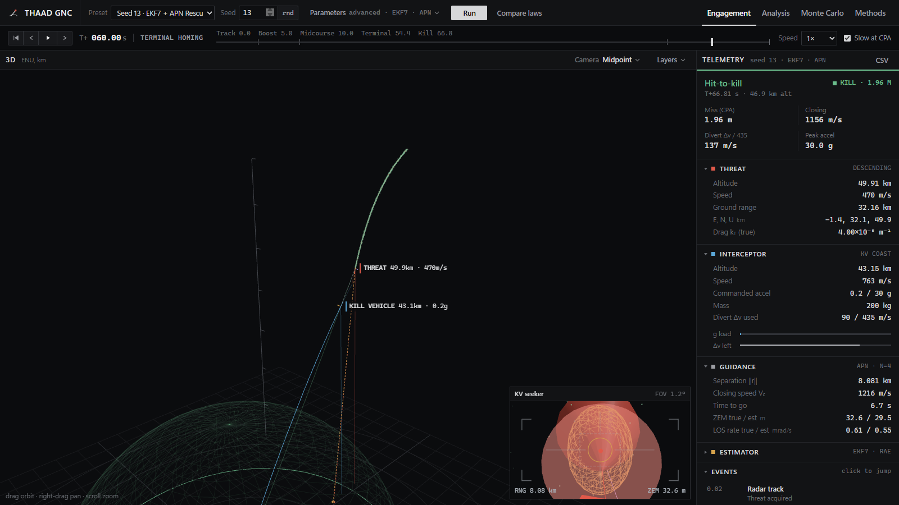
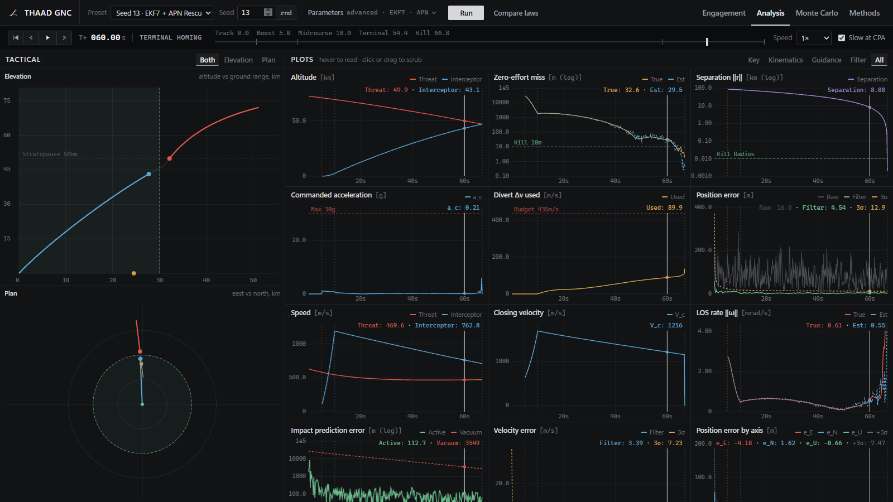
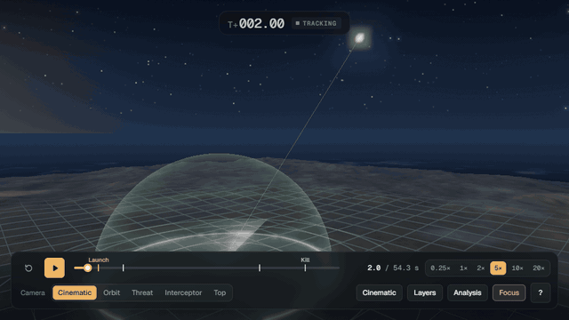

# Visualization Interfaces & Frontend Development

All engagement physics, estimation, guidance, and Monte Carlo execution live in the Python package (`thaad_sim/`). The repository provides two complementary browser interfaces on top of that engine:

1. **Live Workstation** (`python -m thaad_sim --serve`) — A local FastAPI server (`thaad_sim/server.py`) + telemetry builder (`thaad_sim/telemetry.py`) + plain ES modules (`thaad_sim/workstation/`). Every **Run** or **Compare laws** executes the live Python simulation directly.
2. **Static Replay Viewer & Batch Dashboard** (`python -m thaad_sim`, `python -m thaad_sim.dashboard`) — Vite-bundled single-file HTML templates under `thaad_sim/viewer/` (sources in `viewer/src/`) for offline sharing and the [GitHub Pages site](https://yehiagewily.github.io/THAAD-Simulation/).

---

## 1. Live Workstation (`thaad_sim/workstation/`)

Start the server at <http://127.0.0.1:8765>:

```bash
python -m thaad_sim --serve          # --no-browser to skip opening a tab, --port N to change port
```



### Scenario Controls (Top Bar)

- **Preset**: Six curated scenarios (from Seed 13 EKF7 + APN rescue to Seed 68 weapons-hold and Seed 3 max-perf). Selecting a preset or config resets all form controls to that config's baseline before applying overrides.
- **Seed**: Deterministic scenario seed (plus a `rnd` button for a quick random seed).
- **Parameters** popover: Config YAML, filter (`kf6` / `ekf7`), impact predictor (`vacuum` / `drag`), radar (`cartesian` / `rae`), guidance law (`pn` / `apn` / `zem`), navigation gain, divert budget (blank for unlimited), actuator lag $\tau$, and lateral $g$ limit.
- **Compare laws**: Runs `KF6 + PN`, `EKF7 + APN`, and `EKF7 + ZEM` on the active seed and overlays all three trajectories and plots.

### Tabs

| Tab | Contents |
| --- | --- |
| **Engagement** | 3D scene (camera presets, vehicle scale, 8 toggleable layers including radar returns, Kalman track, $3\sigma$ ellipsoid, GNC vectors, and PIP footprint), floating kill-vehicle optical **Seeker Inset**, and collapsible **Telemetry** sidebar (result, threat, interceptor with $g$-load and $\Delta v$-remaining bars, guidance/estimator readouts, and clickable event log). |
| **Analysis** | Synchronized 2D **Elevation** and **Plan** views alongside 14 synchronized time-series plots (kinematics, guidance, filter errors & NEES/NIS consistency, drag estimate, PIP bias) with hover readouts and click/drag scrubbing. |
| **Monte Carlo** | Committed 1000-run batches (`results/*.csv`) or a multi-core live Monte Carlo batch of $N$ seeds with the current parameters (outcome rates with 95% Wilson intervals, histograms, verification tables, and **Open** on any live seed row). |
| **Methods** | Model equations typeset with KaTeX plus the complete resolved parameter table for the loaded run ([screenshot](../docs/figures/workstation_methods.png)). |



### Controls & Shortcuts

| Control | Action |
| --- | --- |
| `Space` | Play / pause |
| `←` / `→` (`Shift` for 1 s) | Step 0.1 s back / forward |
| `Home` / `End` | Jump to start / end |
| Timeline & phase stepper | Drag to scrub; click `Track`, `Boost`, `Midcourse`, `Terminal`, or `Kill` to jump |
| Speed & `Slow at CPA` | Playback speed (`0.25×`–`20×`) and automatic slow-motion around closest approach |
| **CSV** (Telemetry header) | Export the full time series of the loaded run |
| Mouse in 3D | Drag to orbit, right-drag to pan, scroll to zoom |

### Backend API & Frontend Architecture

- **API endpoints** (`thaad_sim/server.py`): `/api/configs`, `/api/simulate`, `/api/compare`, `/api/batch`, `/api/batch/run`.
- **Telemetry pipeline** (`thaad_sim/telemetry.py`): Computes derived kinematic, guidance, Kalman error, and PIP arrays in Python so the browser duplicates no physics.
- **Assets & offline mode**: No build step is required for `thaad_sim/workstation/` (`Cache-Control: no-cache` is sent on reload). Three.js is served from `viewer/node_modules/three` when present (after `npm ci` in `viewer/`) and otherwise falls back to a CDN copy; KaTeX equations in **Methods** fall back to plain text offline.

| Module | Contents |
| --- | --- |
| `app.js` | Controller: run queue/tokens, presets & parameter sync, playback, tabs, telemetry readouts, CSV export |
| `viewport3d.js` | Three.js 3D scene, camera modes, layers, labels, and seeker inset |
| `tactical2d.js` | 2D Elevation and Plan canvases |
| `charts.js` | 14 synchronized GNC/estimator plots |
| `batch_view.js` | Monte Carlo dashboard & Methods view |

With a workstation running on port `8765`, `node viewer/tools/workstation_shots.mjs http://127.0.0.1:8765` captures the `docs/figures/workstation_*.png` screenshots in headless Chrome and fails on any console error (`npm run record-workstation-gif` in `viewer/` records `docs/figures/workstation.gif` using `ffmpeg`).

---

## 2. Static Replay Viewer & Batch Dashboard (`viewer/`)

When running `python -m thaad_sim` without `--serve`, [`replay_viewer.py`](../thaad_sim/replay_viewer.py) injects a single run into a self-contained HTML template (`thaad_sim/viewer/replay_template.html`). Likewise, `python -m thaad_sim.dashboard results/engineering.csv` builds `site/dashboard.html` from `thaad_sim/viewer/dashboard_template.html`.



### Replay Viewer Features & Hotkeys

| Feature | Summary |
| --- | --- |
| **Scene** | Terrain, defended dome & range rings, atmospheric strata, radar returns, Kalman track, 10× exaggerated $3\sigma$ uncertainty ellipsoid (`E`), LOS, 3D GNC vectors, dynamic PIP migration trail & $3\sigma$ footprint, ballistic projection arcs, and CPA kill-radius sphere. |
| **Seeker PiP (`P`)** | Picture-in-picture optical seeker inset with SVG reticle; click inset to toggle chase camera. |
| **Styles (`G`)** | **Scientific** (default: clean trajectories, drop lines, altitude scale, ENU triad) and **Cinematic** (glow, clouds, smoke trails, shock cone, DACS thruster plumes, radar sweep). |
| **In-Browser Sim Lab (`S`)** | Standalone JS port (`viewer/src/replay/sim_engine.js`) allowing parameter exploration inside exported static HTML files without a Python server. |
| **Analysis (`A`)** | Synchronized kinematics, guidance, Kalman filter & NEES/NIS figures, Methods readout, and CSV export. |
| **Deep links** | Hash parameters such as `replay.html#t=40&cam=threat&paused&focus&analysis&tab=kf&style=cinematic`. |

| Control | Action |
| --- | --- |
| `Space` | Play / pause |
| `←` / `→` (`Shift` for 5 s) | Step 1 s back / forward |
| `Home` / `End` | Jump to start / end |
| `1`–`6` | Playback speed `0.25×`–`20×` |
| `C` `O` `T` `I` `V` | Camera: cinematic, free orbit, chase threat, chase interceptor, top-down |
| `R` `K` `E` `L` `X` `P` `H` `M` | Toggle radar returns, Kalman track, $3\sigma$ ellipsoid, LOS, GNC vectors & PIP, seeker PiP, labels, slow-motion |
| `S` / `A` / `G` / `F` / `?` | Sim Lab / Analysis panel / Scientific–Cinematic style / Focus mode / Shortcuts |
| Mouse | Drag to orbit, scroll to zoom, right-drag to pan |

### Rebuilding the Single-File Templates

The built templates in `thaad_sim/viewer/` are committed, so running the simulation never requires Node.js. If you edit files under `viewer/src/`:

```bash
cd viewer
npm ci
npm run build      # rebuilds thaad_sim/viewer/replay_template.html & dashboard_template.html
npm run dev        # Vite live-reload against your latest replay in replays/ & site/
```

| Module (`viewer/src/`) | Contents |
| --- | --- |
| `replay/data.js` | Payload parsing, scene units, interpolation, GNC/PIP/CPA series |
| `replay/sim_engine.js` | Client-side RK4 + KF6/EKF7 + RAE/Cartesian + PN/APN/ZEM engine for static Sim Lab (`S`) |
| `replay/scene.js` | Renderer, main & seeker cameras, sky, terrain, clouds, strata, labels |
| `replay/models.js` | Threat, interceptor, DACS thruster plumes, and booster meshes |
| `replay/effects.js` | Trails, radar returns, explosions, LOS, 3D GNC vectors, PIP & CPA sphere |
| `replay/covariance.js` | Spherical / oriented $3\sigma$ covariance ellipsoid |
| `replay/director.js` | Directed camera & CPA endgame framing |
| `replay/charts.js`, `replay/analysis.js` | Interactive mini-chart, synchronized figures, Analysis drawer, Methods tab |
| `replay/ui.js`, `replay/palette.js` | HUD, shortcuts, Sim Lab modal, color-blind-safe palette |
| `dashboard/` | Static batch dashboard & SVG charts |

Automated checks: `node tools/check_views.mjs ../site/replay.html` screenshots every camera and tests keyboard shortcuts in headless Chrome; `.github/workflows/pages.yml` builds and deploys the curated static demos from `docs/site/`.

